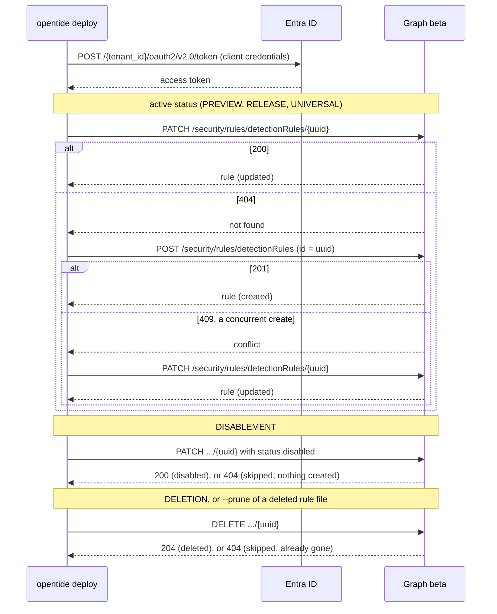

# RFC 0021: Microsoft Defender on the Graph beta custom detection contract

- **RFC:** 0021
- **Title:** Microsoft Defender on the Graph beta custom detection contract (`microsoft_defender`)
- **Type:** platform
- **Author:** opentide maintainers
- **Status:** accepted
- **Created:** 2026-11-24
- **Accepted:** 2026-11-25, by the owner. opentide 1.0 ships Microsoft Defender as `microsoft_defender` on the Microsoft Graph beta custom detection contract, with the rule's `metadata.uuid` as the Defender rule id. The pre-1.0 `defender_for_endpoint` platform is removed and has no successor path. The normative text is:
  - [specs/platforms/microsoft-defender-1.0.md](../specs/platforms/microsoft-defender-1.0.md) 1.0, and 1.1 with the revision below;
  - [specs/platforms/defender-for-endpoint-1.0.md](../specs/platforms/defender-for-endpoint-1.0.md) 1.4 (removed, kept as a record);
  - [specs/deployment-state.md](../specs/deployment-state.md) 1.10, [specs/deployment.md](../specs/deployment.md) 1.5, [specs/workspace.md](../specs/workspace.md) 1.6;
  - [specs/platforms/index.md](../specs/platforms/index.md) 1.11, [specs/validation.md](../specs/validation.md) 1.16, [specs/visibility.md](../specs/visibility.md) 1.2.
- **Revised:** 2026-11-25. The RFC was brought to the standard of the other platform RFCs ([0007](0007-elastic-security-platform.md), [0016](0016-bitdefender-gravityzone-platform.md), [0017](0017-graylog-platform.md), [0018](0018-exabeam-platform.md), [0019](0019-google-secops-yara-l.md)): research, the full YAML shape, a field table, the Graph request for the complete example, the deploy lifecycle, tenant setup, every code, the upgrade, and the tenant test plan. No decision changed. The spec, at 1.1, gained the tenant setup, errors and retries, the deploy outputs, and a minimal example.
- **Supersedes:** [RFC 0010](0010-deployment-external-ids.md) for Microsoft Defender for Endpoint only
- **Issue:** [#104](https://github.com/opentidehq/specifications/issues/104)
- **Related:** [RFC 0007](0007-elastic-security-platform.md) (the uuid as the vendor rule id); [RFC 0010](0010-deployment-external-ids.md) (deployment state, which this platform no longer needs)
- **Implementation:** opentidehq/opentide, for 1.0.0 GA: [#1856](https://github.com/opentidehq/opentide/pull/1856) (rename to `microsoft_defender`, 1/3), [#1860](https://github.com/opentidehq/opentide/pull/1860) (model, validation, compiler, and deployer, 2/3), [#1861](https://github.com/opentidehq/opentide/pull/1861) (documentation and changelog, 3/3). Tenant test plan: [`docs/internal/microsoft-defender-tenant-test.md`](https://github.com/opentidehq/opentide/blob/integration/unified-core/docs/internal/microsoft-defender-tenant-test.md) on `integration/unified-core`.

## Summary

opentide 1.0 adds **`microsoft_defender`** (Microsoft Defender), a Microsoft Defender XDR custom detection platform with the block schema **`platform::microsoft_defender::1.0`**. Its contract is the Microsoft Graph **beta** custom detection API, `https://graph.microsoft.com/beta/security/rules/detectionRules`. The block models every writable beta property, and its constraints are the ones the docs state:

- `schedule`: an ISO 8601 frequency and a beta lookback;
- `alert`: title, description, severity, recommendation, techniques, custom details, and beta event grouping, with `tactics` derived from the techniques through the bundled ATT&CK vocabulary;
- `entities`: Graph's seventeen entity kinds;
- `actions`: Graph's sixteen automated actions;
- `scope.device_groups`, a beta `incident` block, and `status` from the deployment status.

The Defender rule id is the rule's **`metadata.uuid`**. Graph takes a client-provided `id` on create, so the platform is addressed like Sentinel and Elastic and keeps no deployment state. Deploy sends `PATCH` to the rule's uuid, and creates the rule with `POST` only when the `PATCH` answers `404`.

The pre-1.0 `defender_for_endpoint` platform is removed. opentide 1.0 is the first release, and that platform existed only in pre-1.0 betas, so it has no deprecation period and no tooling. `configurations.defender_for_endpoint` is an unknown key, and its shard key is gone. [§13](#13-breaking-change-and-upgrade) says what a beta user does by hand.

## Motivation

### Microsoft removed the properties the old platform sent

Microsoft deprecated, then **removed on 2026-10-01**, the custom detection properties the pre-1.0 `defender_for_endpoint` platform deployed to. Each has a replacement:

| Removed property | Replacement |
|------------------|-------------|
| `isEnabled` | `status` (`enabled`, `disabled`) |
| `schedule.period` | `schedule.frequency` (ISO 8601) |
| `alertTemplate.category` | `alertTemplate.tactics` |
| `alertTemplate.mitreTechniques` | `alertTemplate.tactics` (techniques nested in tactics) |
| `alertTemplate.impactedAssets` | `alertTemplate.entityMappings` |
| `detectionAction.responseActions` | `detectionAction.automatedActions` |
| `organizationalScope.scopeType`, `scopeNames` | `organizationalScope.deviceGroups` |

That platform's block had the shape of the removed wire format: one `scheduling` string, three `impacted_entities` columns, and response actions grouped by devices, files, and users. It could not be repaired with a minor version. Every request it built after 2026-10-01 sends removed properties.

### Why Graph beta

Microsoft is slow to promote features to Graph v1.0. Three properties opentide needs exist only in beta:

| Graph property (beta only) | Block key | What it gives |
|----------------------------|-----------|---------------|
| `schedule.lookback` | `schedule.lookback` | A window longer than the frequency (`1H` frequency, `4H` lookback), so late-arriving events are still matched. |
| `alertTemplate.eventGroupingKind` | `alert.grouping` | `singleAlert`: one alert per run instead of one per result row. |
| `detectionAction.incidentConfiguration` | `incident` | `isExcludedFromIncidentCorrelation`: keep a rule's alerts out of correlated incidents. |

Every other property the block sends exists in v1.0 with the same name and shape ([§10](#10-the-beta-api-is-the-contract)). opentide targets beta only, on purpose; the risk is weighed in [Risks of depending on a beta API](#risks-of-depending-on-a-beta-api).

### Why the name `microsoft_defender`

Microsoft has dropped the "for Endpoint" name. The custom detection rule is a Defender XDR object: one query reads the Endpoint (`Device*`), Office 365 (`Email*`), Identity (`Identity*`), and Cloud Apps (`CloudAppEvents`) tables, and its entity kinds and automated actions cover mailboxes, users, and cloud resources. A key named `defender_for_endpoint` would describe a third of the platform. The identifier is the same everywhere: the configuration key, `--platform`, `.opentide/configurations/platforms/microsoft_defender.toml`, the capability matrix, the `--live` allowlist, visibility log sources, and the `microsoft_defender_` code prefix.

### Why the uuid is the Defender rule id

The create request takes a client-provided `id`: "the client-provided unique identifier of the rule. Required." So the rule's `metadata.uuid` can be the Defender rule id in every tenant:

- one id per rule across tenants, known before the first deploy, so a dry run shows the exact URL;
- no deployment-state shard, so none of [RFC 0010](0010-deployment-external-ids.md)'s machinery: no CI create guards, no orphan creates, no committed state to keep in step;
- alerts and the portal show the uuid, which finds the rule file directly;
- `--prune` retires a deleted rule file by its uuid, as on Sentinel and Elastic.

Recording, in state, an id that always equals `metadata.uuid` would add a file to commit and a way to get out of step, and nothing else.

## Research

Sources: the Microsoft Graph documentation source, beta and v1.0, at [`microsoftgraph/microsoft-graph-docs-contrib`](https://github.com/microsoftgraph/microsoft-graph-docs-contrib) (`api-reference/beta/`), read on 2026-11-25 and snapshotted in [graph-beta-properties.json](../fixtures/platforms/microsoft-defender/graph-beta-properties.json). The pages are listed under [References](#references).

### The custom detection API

| Item | Fact |
|------|------|
| Collection | `https://graph.microsoft.com/beta/security/rules/detectionRules` (`{base}` below) |
| Create | `POST {base}` with a `detectionRule`, `id` included. `201 Created` with the rule. |
| Update | `PATCH {base}/{id}` with the properties to change. `200 OK` with the rule. |
| Delete | `DELETE {base}/{id}`. `204 No Content`. |
| Read | `GET {base}/{id}`; `GET {base}` lists, paged with `@odata.nextLink`. Deploy calls neither. |
| Authentication | Microsoft Entra ID OAuth 2.0 client credentials: `POST https://login.microsoftonline.com/{tenant_id}/oauth2/v2.0/token` with `scope=https://graph.microsoft.com/.default`. The bearer token goes in `Authorization`. |
| Permissions | Create, update, and delete: application permission **`CustomDetection.ReadWrite.All`**, the least and only privilege listed. Advanced hunting (`runHuntingQuery`, used by `--live` and `opentide query`): **`ThreatHunting.Read.All`**. The pages' Defender RBAC roles (Detection tuning, Security Administrator) apply to delegated, signed-in use, not to an app registration. |
| Errors | Graph's error envelope, `{"error": {"code", "message"}}`. The update and delete pages document only their success codes ([question 2](#unresolved-questions)). |
| Throttling | Graph answers `429` with `Retry-After`. |

### The types

The API uses 36 types and 130 properties: `detectionRule`, `queryCondition`, `ruleSchedule`, `detectionAction`, `alertTemplate`, `alertCustomDetails`, `entityMappingConfiguration` and its seventeen `*EntityMapping` types, `mitreTactic`, `mitreTechnique`, `automatedActionSet` and its seven action types, `organizationalScope`, and `incidentConfiguration`. Each property is read-only, deprecated, set by deploy, or modelled by a block key ([§10](#10-the-beta-api-is-the-contract)).

The enums the block uses:

| Enum | Values | Block |
|------|--------|-------|
| `detectionRuleStatus` | `enabled`, `disabled`, `autoDisabled`, `unknownFutureValue` | `status` sends `enabled` or `disabled` |
| `alertSeverity` | `informational`, `low`, `medium`, `high`, `unknownFutureValue` | `alert.severity` |
| `eventGroupingKind` | `alertPerEvent`, `singleAlert`, `unknownFutureValue` | `alert.grouping` |
| `isolationType` | `full`, `selective`, `unknownFutureValue` | `isolation_type` |

`unknownFutureValue` is Graph's evolvable-enum sentinel ("Don't use `unknownFutureValue` in requests"), and `autoDisabled` is set by Defender on a rule that keeps failing.

### What the docs say, and what they leave open

The docs state few constraints: the enums above, `lookback` "must be at least **frequency**", and no lookback on near-real-time rules "with a zero frequency". They give no allowed frequencies, no largest lookback, no required field of an entity mapping or action target, no custom-detail limits, no constraints on `id`, no tactic values, and no error codes for an unknown id. The spec enforces what the docs state, marks opentide's own shape rules as opentide's, and takes a stated position on the rest. The nine positions are the [unresolved questions](#unresolved-questions), each with a check in the [tenant test plan](#tenant-test-plan).

## Detailed design

The normative text is [microsoft-defender-1.0](../specs/platforms/microsoft-defender-1.0.md). This section restates it with the examples and the reasons. Where they differ, the spec wins.

### 1. Affected specs

| Path | Change |
|------|--------|
| `specs/platforms/microsoft-defender-1.0.md` | **New**, spec version 1.0, `schema_id: platform::microsoft_defender::1.0`, `status: normative`. |
| `specs/platforms/defender-for-endpoint-1.0.md` | 1.3 → **1.4**: marked removed (`status: deprecated`, the term [GOVERNANCE](../GOVERNANCE.md) has for a withdrawn spec), kept as a record, defining no behaviour. Its fixture is removed. |
| `specs/deployment-state.md` | 1.9 → **1.10**. `defender_for_endpoint` leaves the state-backed platforms and the shard; `microsoft_defender` keeps no shard. The shard JSON Schema drops the key. |
| `specs/deployment.md` | 1.4 → **1.5**. Microsoft Defender needs no binding; `--prune` retires a deleted rule by uuid. |
| `specs/platforms/index.md` | 1.10 → **1.11**. Schema table, capability matrix, `--live` allowlist, static-validation bar, external-id table, generated defaults. |
| `specs/validation.md` | 1.15 → **1.16**. `--live` allowlist; advisory `microsoft_defender_no_entities`; fixture checker. |
| `specs/workspace.md` | 1.5 → **1.6**. Shard directory description. |
| `specs/visibility.md` | 1.1 → **1.2**. The Defender KQL system is `microsoft_defender`. |
| `specs/objects/rule-1.0.md`, `rule-1.1.md` | `configurations.microsoft_defender` replaces `configurations.defender_for_endpoint`. |
| `specs/platforms/exabeam-1.0.md` | Prose: no longer cites Defender for Endpoint as state-backed. |
| `rfcs/0010-deployment-external-ids.md` | Marked superseded in part, for Defender for Endpoint. |
| `SPECS.md`, `CHANGELOG.md`, `rfcs/README.md`, `llms.txt`, `site/meta.json` | Index rows. |

Vocabularies: none change.

### 2. Shape

#### 2.1 Complete block

Every key the block defines, each set once, with the shared keys ([platforms](../specs/platforms/index.md#shared-platform-block)). It is the spec's complete example and the fixture [microsoft-defender-complete.yaml](../fixtures/platforms/microsoft-defender-complete.yaml) (a test keeps the three equal). It shows the shape, not a rule to deploy: a real rule's query returns only the columns its mappings name, and the rule picks only the actions it needs.

```yaml
configurations:
  microsoft_defender:
    enabled: true                         # shared; false (the default) keeps the block out of deploy
    name: Encoded PowerShell with follow-on activity   # shared → displayName; empty: the rule name
    schema: platform::microsoft_defender::1.0          # optional; when set, exactly this
    status: PRODUCTION                    # shared; a deployment.toml status → Graph status
    tenants: [contoso, fabrikam]          # shared; omitted: every tenant the run reaches
    flags: [tier0]                        # shared; matched by modifiers, not sent
    contributors: [Detection Engineering] # shared; not sent
    # Illustrative: this block sets every key so each one is shown once. A real rule's query
    # returns exactly the columns its mappings and actions name, and picks only the actions it needs.
    query: |                              # required → queryCondition.queryText (with exclusions)
      DeviceProcessEvents
      | where FileName =~ "powershell.exe" and ProcessCommandLine has "-enc"
      | join kind=leftouter (DeviceNetworkEvents | project DeviceId, RemoteIP, RemoteIPType, RemoteUrl, LocalIP) on DeviceId
      | project Timestamp, ReportId, DeviceId, DeviceName, DeviceDnsDomain, DeviceNetBiosName, DeviceNtDomain,
          AccountObjectId, AccountSid, AccountUpn, AccountUpnSuffix, AccountName, AccountDomain, AccountDnsDomain,
          FileName, SHA1, SHA256, InitiatingProcessSHA1, InitiatingProcessSHA256, ProcessCommandLine,
          RemoteIP, RemoteIPType, RemoteUrl, DnsQuery, LocalIP, DnsServerIP, RegistryKey, RegistryValueName,
          NetworkMessageId, RecipientEmailAddress, SenderFromAddress, Subject, MailClusterQuery, MailClusterSource,
          ApplicationId, Application, OAuthApplicationId, GroupObjectId, GroupSid, GroupDistinguishedName,
          AzureResourceId, AmazonResourceName, GcpFullResourceName
    schedule:
      frequency: 1H                       # required; NRT | <n>H | <n>D → PT1H
      lookback: 4H  # beta-only           # <n>H | <n>D, ≥ frequency, never with NRT → PT4H
    alert:
      title: Encoded PowerShell with follow-on activity   # default: the rule name
      description: An encoded PowerShell command ran and was followed by network, mail, and identity activity.
      severity: High                      # Informational | Low | Medium | High | Critical → high
      recommendation: Review the decoded command line, isolate the device, and reset the account's credentials.
      techniques: [T1059.001, T1078.004]  # default: the objective's; → tactics, derived
      custom_details:                     # detail name → result column
        CommandLine: ProcessCommandLine
        RemoteAddress: RemoteIP
      grouping: single_alert  # beta-only # alert_per_event | single_alert → singleAlert
    entities:                             # kind → list of mappings; field → result column
      hosts:
        - device_id: DeviceId
          name: DeviceName
          dns_domain: DeviceDnsDomain
          netbios_name: DeviceNetBiosName
          nt_domain: DeviceNtDomain
      accounts:
        - aad_user_id: AccountObjectId
          sid: AccountSid
          upn: AccountUpn
          upn_suffix: AccountUpnSuffix
          name: AccountName
          nt_domain: AccountDomain
          dns_domain: AccountDnsDomain
      mailboxes:
        - primary_address: RecipientEmailAddress
      files:
        - name: FileName
          sha1: SHA1
          sha256: SHA256
      processes:
        - sha1: InitiatingProcessSHA1
          sha256: InitiatingProcessSHA256
      ips:
        - address: RemoteIP
          scope: RemoteIPType
      urls:
        - address: RemoteUrl
      dns:
        - domain_name: DnsQuery
          host_ip_address: LocalIP
          server_ip: DnsServerIP
      registry_values:
        - key: RegistryKey
          value_name: RegistryValueName
      mail_messages:
        - network_message_id: NetworkMessageId
          recipient: RecipientEmailAddress
          sender: SenderFromAddress
          subject: Subject
      mail_clusters:
        - query: MailClusterQuery
          source: MailClusterSource
      cloud_applications:
        - app_id: ApplicationId
          name: Application
      oauth_applications:
        - oauth_app_id: OAuthApplicationId
      security_groups:
        - object_id: GroupObjectId
          sid: GroupSid
          distinguished_name: GroupDistinguishedName
      azure_resources:
        - resource_id: AzureResourceId
      amazon_resources:
        - amazon_resource_id: AmazonResourceName
      google_cloud_resources:
        - full_resource_name: GcpFullResourceName
    actions:                              # action → list of targets; *Column fields → result column
      isolate_devices:
        - device_id: DeviceId
          isolation_type: selective       # full | selective
      collect_investigation_packages:
        - device_id: DeviceId
      run_antivirus_scans:
        - device_id: DeviceId
      initiate_investigations:
        - device_id: DeviceId
      restrict_app_executions:
        - device_id: DeviceId
      allow_files:
        - sha1: SHA1
          sha256: SHA256
          device_groups: [Developer workstations]   # omitted: every device group
      block_files:
        - sha1: SHA1
          sha256: SHA256
          device_groups: [Tier 0, Servers]
      stop_and_quarantine_files:
        - device_id: DeviceId
          sha1: SHA1
      disable_users:
        - account_sid: AccountSid
      force_user_password_resets:
        - account_sid: AccountSid
      mark_users_as_compromised:
        - account_object_id: AccountObjectId
      soft_delete_emails:
        - network_message_id: NetworkMessageId
          recipient: RecipientEmailAddress
      hard_delete_emails:
        - network_message_id: NetworkMessageId
          recipient: RecipientEmailAddress
      move_emails_to_deleted_items:
        - network_message_id: NetworkMessageId
          recipient: RecipientEmailAddress
      move_emails_to_inbox:
        - network_message_id: NetworkMessageId
          recipient: RecipientEmailAddress
      move_emails_to_junk:
        - network_message_id: NetworkMessageId
          recipient: RecipientEmailAddress
    scope:                                # omitted: every device
      device_groups: [Tier 0, Servers]
    incident:  # beta-only
      exclude_from_correlation: true      # true: each alert opens its own incident
    exclusions:                           # appended to query, per tenant; not sent as such
      - query: '| where DeviceName != BuildAgent'
        reason: The build agent runs encoded PowerShell on purpose.
        tenant: fabrikam
        let:
          BuildAgent: build-agent-01
```

#### 2.2 Minimal block

`query` and `schedule.frequency` are the only required keys. Every other value has a deploy-time default or is not sent.

```yaml
configurations:
  microsoft_defender:
    enabled: true
    status: STAGING
    query: |
      DeviceProcessEvents
      | where FileName =~ "powershell.exe" and ProcessCommandLine has "-enc"
      | project Timestamp, ReportId, DeviceId, DeviceName
    schedule:
      frequency: 1H
    entities:
      hosts:
        - device_id: DeviceId
```

The `entities` mapping is optional; without one, validation reports the advisory `microsoft_defender_no_entities` and the rule still deploys. Deployed with rule `name` "Encoded PowerShell", `response.alert_severity: High`, and an objective mapped to T1059.001, this block sends `displayName` and `alertTemplate.title` "Encoded PowerShell", `severity: high`, `schedule: {frequency: PT1H}`, `tactics: [{tactic: Execution, techniques: [{technique: T1059, subTechniques: [T1059.001]}]}]`, and no `lookback`, `eventGroupingKind`, `automatedActions`, `organizationalScope`, or `incidentConfiguration`.

### 3. Block fields

Paths are under `configurations.microsoft_defender`. "Not sent" means the Graph property is omitted, never sent as `null`.

| Key | Type | Required | Default | Allowed values or pattern | Graph property | Notes |
|-----|------|----------|---------|---------------------------|----------------|-------|
| `enabled` | boolean | no | `false` | — | — | Shared. Only an enabled block deploys. |
| `name` | string | no | `""` | — | `displayName` | Shared. Empty: the rule `name`. |
| `schema` | string | no | null | `platform::microsoft_defender::1.0` | — | `microsoft_defender_schema` |
| `status` | string | no | null | a status of `deployment.toml` | `status` | Shared. Its strategy picks the call and `enabled` or `disabled` ([§8](#8-deploy-lifecycle)). |
| `tenants` | list[string] | no | null | configured tenant names | — | Shared. Omitted: every tenant the run reaches. |
| `flags` | list[string] | no | null | — | — | Shared. Modifiers match on them. |
| `contributors` | list[string] | no | null | — | — | Shared. Not sent. |
| `query` | string | **yes** | — | non-blank KQL | `queryCondition.queryText` | Compiled with the tenant's matching `exclusions`. |
| `schedule.frequency` | string | **yes** | — | `NRT`, or `^[1-9][0-9]*[HD]$` | `schedule.frequency` | `NRT` → `PT0S`, `<n>H` → `PT<n>H`, `<n>D` → `P<n>D` |
| `schedule.lookback` | string | no | not sent | `^[1-9][0-9]*[HD]$`; at least `frequency`; not with `NRT` | `schedule.lookback` | **Beta-only.** Not sent: Defender derives it from the frequency. `1D` counts as `24H`. |
| `alert.title` | string | no | rule `name` | — | `alertTemplate.title` | |
| `alert.description` | string | no | rule `description` | — | `alertTemplate.description` | |
| `alert.severity` | string | no | `response.alert_severity`, else `Medium` | `Informational`, `Low`, `Medium`, `High`, `Critical` | `alertTemplate.severity` | Sent lower-cased; `Critical` → `high`. |
| `alert.recommendation` | string | no | not sent | — | `alertTemplate.recommendedActions` | |
| `alert.techniques` | list[string] | no | the objective's techniques | ATT&CK Enterprise ids, `T1059` or `T1059.001` | `alertTemplate.tactics` | Derived tree ([§5](#5-derived-fields)). An empty list counts as unset. |
| `alert.custom_details` | map[string, string] | no | not sent | non-blank name → column | `alertTemplate.customDetails` | Sent as written. |
| `alert.grouping` | string | no | not sent | `alert_per_event`, `single_alert` | `alertTemplate.eventGroupingKind` | **Beta-only.** `alertPerEvent`, `singleAlert`. Not sent: one alert per event. |
| `entities.<kind>` | list[map] | no | not sent | a kind of [§3.1](#31-entity-kinds) | `alertTemplate.entityMappings.<Graph kind>` | Each mapping names at least one of its kind's fields. |
| `entities.<kind>[].<field>` | string | — | — | non-blank column | `<field>Column` in camelCase | Sent verbatim. |
| `actions.<action>` | list[map] | no | not sent | an action of [§3.2](#32-automated-actions) | `detectionAction.automatedActions.<Graph action>` | A non-empty list of targets. |
| `actions.<action>[].<field>` | string | — | — | non-blank column | `<field>Column` in camelCase | Only the action's own fields. |
| `actions.isolate_devices[].isolation_type` | string | no | not sent | `full`, `selective` | `isolationType` | |
| `actions.allow_files[].device_groups`, `actions.block_files[].device_groups` | list[string] | no | not sent | non-empty, non-blank names | `deviceGroupNames` | Not sent: every device group. |
| `scope.device_groups` | list[string] | yes, in `scope` | — | non-empty, non-blank names | `detectionAction.organizationalScope.deviceGroups` | No `scope`: every device. |
| `incident.exclude_from_correlation` | boolean | yes, in `incident` | — | `true`, `false` | `detectionAction.incidentConfiguration.isExcludedFromIncidentCorrelation` | **Beta-only.** No `incident`: not sent, Defender's default (correlated). |
| `exclusions[].query` | string | yes | — | KQL fragment, may be empty | part of `queryText` | Appended after `query`. |
| `exclusions[].reason` | string | yes | — | — | — | Not sent. |
| `exclusions[].tenant` | string | no | null | a tenant name | — | Limits the exclusion to one tenant. |
| `exclusions[].let` | map[string, scalar] | no | null | string, number, boolean | part of `queryText` | KQL `let` bindings before the query. |

Any other key fails `unknown_field`, at any depth. `rule_id`, `rule_id_bundle`, and `rule_id::<tenant>` fail `external_id_in_rule`.

#### 3.1 Entity kinds

A field's key is its Graph property without `Column`, in snake_case.

| `entities.` kind | Graph kind | Fields |
|------------------|------------|--------|
| `hosts` | `hosts` | `device_id`, `name`, `dns_domain`, `netbios_name` (`netBiosNameColumn`), `nt_domain` |
| `accounts` | `accounts` | `aad_user_id`, `sid`, `upn`, `upn_suffix`, `name`, `nt_domain`, `dns_domain` |
| `mailboxes` | `mailboxes` | `primary_address` |
| `files` | `files` | `name`, `sha1`, `sha256` |
| `processes` | `processes` | `sha1`, `sha256` |
| `ips` | `ips` | `address`, `scope` |
| `urls` | `urls` | `address` |
| `dns` | `dns` | `domain_name`, `host_ip_address`, `server_ip` |
| `registry_values` | `registryValues` | `key`, `value_name` |
| `mail_messages` | `mailMessages` | `network_message_id`, `recipient`, `sender`, `subject` |
| `mail_clusters` | `mailClusters` | `query`, `source` |
| `cloud_applications` | `cloudApplications` | `app_id`, `name` |
| `oauth_applications` | `oAuthApplications` | `oauth_app_id` (`oAuthAppIdColumn`) |
| `security_groups` | `securityGroups` | `object_id`, `sid`, `distinguished_name` |
| `azure_resources` | `azureResources` | `resource_id` |
| `amazon_resources` | `amazonResources` | `amazon_resource_id` |
| `google_cloud_resources` | `googleCloudResources` | `full_resource_name` |

The spec's [entities table](../specs/platforms/microsoft-defender-1.0.md#entities-defenderentities) gives every field's Graph property.

#### 3.2 Automated actions

| `actions.` action | Graph action | Target fields |
|-------------------|--------------|---------------|
| `isolate_devices` | `isolateDevices` | `device_id`, `isolation_type` |
| `collect_investigation_packages` | `collectInvestigationPackages` | `device_id` |
| `run_antivirus_scans` | `runAntivirusScans` | `device_id` |
| `initiate_investigations` | `initiateInvestigations` | `device_id` |
| `restrict_app_executions` | `restrictAppExecutions` | `device_id` |
| `allow_files`, `block_files` | `allowFiles`, `blockFiles` | `sha1`, `sha256`, `device_groups` (`deviceGroupNames`) |
| `stop_and_quarantine_files` | `stopAndQuarantineFiles` | `device_id`, `sha1` |
| `disable_users`, `force_user_password_resets` | `disableUsers`, `forceUserPasswordResets` | `account_sid` |
| `mark_users_as_compromised` | `markUsersAsCompromised` | `account_object_id` |
| `soft_delete_emails`, `hard_delete_emails`, `move_emails_to_deleted_items`, `move_emails_to_inbox`, `move_emails_to_junk` | `softDeleteEmails`, `hardDeleteEmails`, `moveEmailsToDeletedItems`, `moveEmailsToInbox`, `moveEmailsToJunk` | `network_message_id`, `recipient` |

### 4. Validation

Static validation (`opentide validate`, the `schema` check) MUST reject a block that breaks a constraint, under its code. Each constraint is marked with where it comes from: **Graph** when the beta docs state it, **opentide** when it is a shape rule of the YAML. Paths are under `configurations.microsoft_defender`.

| Code | Source | Trigger | Message gist | Example that fails | Fixture |
|------|--------|---------|--------------|--------------------|---------|
| `microsoft_defender_schema` | opentide | `schema` set to anything but `platform::microsoft_defender::1.0` | the block's `schema` names another schema | `schema: platform::microsoft_defender::2.0` | — |
| `microsoft_defender_frequency` | opentide | `schedule.frequency` is not `NRT`, `<n>H`, or `<n>D` | the frequency is not `NRT`, `<n>H` or `<n>D` | `frequency: PT1H` | — |
| `microsoft_defender_lookback` | Graph and opentide | `lookback` is not `<n>H`/`<n>D` (opentide), is set with `NRT` (Graph), or is shorter than `frequency` (Graph) | the lookback is not a duration, is on a near-real-time rule, or is shorter than its frequency | `frequency: NRT` with `lookback: 1H` | [lookback-nrt](../fixtures/invalid/rule-microsoft-defender-lookback-nrt.yaml) |
| `microsoft_defender_severity` | opentide | `alert.severity` is not one of the five names, exact case | not one of opentide's five severities | `severity: high` | — |
| `microsoft_defender_grouping` | Graph | `alert.grouping` is not `alert_per_event` or `single_alert` | not `alert_per_event` or `single_alert` | `grouping: singleAlert` | — |
| `microsoft_defender_custom_details` | opentide | `alert.custom_details` is not a map of non-blank names to strings | not a mapping of non-blank names to result columns | `custom_details: [ProcessCommandLine]` | — |
| `microsoft_defender_entity_kind` | Graph | a key of `entities` is not one of the seventeen kinds | not an entity kind | `entities: {devices: [...]}` | — |
| `microsoft_defender_entity_mapping` | Graph and opentide | a kind is not a list, a mapping is empty (opentide), or a mapping names a field its kind does not have (Graph) | the mapping is empty, not a mapping, or names a field its kind does not have | `hosts: [{device_id: DeviceId, sid: AccountSid}]` | [entity-field](../fixtures/invalid/rule-microsoft-defender-entity-field.yaml) |
| `microsoft_defender_action_kind` | Graph | a key of `actions` is not one of the sixteen actions | not an automated action | `actions: {isolate_device: [...]}` | — |
| `microsoft_defender_action_target` | Graph and opentide | an action's list is empty, a target is empty or names another action's field, or `device_groups` is empty or holds a blank name | no target, an empty target, or a field its action does not take | `block_files: [{sha256: SHA256, device_id: DeviceId}]` | [action-target](../fixtures/invalid/rule-microsoft-defender-action-target.yaml) |
| `microsoft_defender_isolation_type` | Graph | `isolation_type` is not `full` or `selective` | not `full` or `selective` | `isolation_type: Full` | — |
| `microsoft_defender_column` | opentide | a column name (entity field, action column, custom detail value) is blank or not a string | the column name is blank or not a string | `hosts: [{device_id: ""}]` | — |
| `microsoft_defender_scope` | opentide | `scope` is not `{device_groups: [...]}` with a non-empty list of non-blank names | not a non-empty list of device group names | `scope: {device_groups: []}` | — |
| `microsoft_defender_incident` | opentide | `incident` is not `{exclude_from_correlation: true or false}` | `exclude_from_correlation` is not `true` or `false` | `incident: {exclude_from_correlation: yes please}` | — |
| `unknown_field` | opentide | a key the block does not define, at any level | unknown key | `scheduling: 1H` | [unknown-key](../fixtures/invalid/rule-microsoft-defender-unknown-key.yaml) |
| `external_id_in_rule` | opentide | `rule_id`, `rule_id_bundle`, or `rule_id::<tenant>` in the block | external ids never live in the rule | `rule_id: 0f1e…` | — |

Every Graph enum value of a modelled property is accepted, except `unknownFutureValue` and `autoDisabled`. Where the docs say nothing (frequencies, largest lookback, required mapping fields, custom-detail limits), validation checks the type only, and Defender's answer at deploy decides.

Advisory and deploy diagnostics:

| Code | Level | Raised by | When | Message gist |
|------|-------|-----------|------|--------------|
| `microsoft_defender_no_entities` | warning | `opentide validate`, `opentide lint` | `entities` is unset, empty, or holds only empty kinds | the alert names no device, user, or mailbox, so it cannot be triaged or acted on by entity |
| `technique_not_enterprise_left_out` | warning | deploy, dry run | an id is outside Enterprise ATT&CK or unknown to the vocabulary | names the rule and the id left out of `tactics` |
| `microsoft_defender_rule_absent` | warning | deploy | a `DISABLEMENT` `PATCH` answered `404` | `rule <uuid> is not on tenant '<tenant>': nothing to disable` |
| `tenant_refused` | error | deploy | any other non-2xx answer to a rule call | `Graph refused to <verb> detection rule <uuid> on tenant <tenant>: HTTP <status> (<Graph message>)` |

`opentide validate query --platform microsoft_defender --live` adds one check of its own ([§9](#9-query-validation)): the query's output lacks a column Defender requires.

The invalid fixtures each declare their expected code in their first line, and a test checks the line against the code the checker reports.

### 5. Derived fields

| Graph property | Derivation |
|----------------|------------|
| `id` | `metadata.uuid`, canonical and lower-cased. Create only. |
| `displayName` | block `name`, else rule `name` |
| `description` | rule `description`, as written |
| `status` | `enabled` for `PREVIEW`, `RELEASE`, `UNIVERSAL`; `disabled` for `DISABLEMENT` |
| `queryCondition.queryText` | `query`, then each `exclusions[]` entry whose `tenant` is unset or names this tenant, with its `let` bindings ([sentinel-1.0](../specs/platforms/sentinel-1.0.md#exclusions-sentinelexclusion)) |
| `schedule.frequency`, `schedule.lookback` | `NRT` → `PT0S`; `<n>H` → `PT<n>H`; `<n>D` → `P<n>D` |
| `alertTemplate.title`, `.description` | `alert.title`, `alert.description`, else the rule's `name` and `description` |
| `alertTemplate.severity` | `alert.severity`, else `response.alert_severity`, else `Medium`; lower-cased; `Critical` → `high` |
| `alertTemplate.tactics` | the technique tree below |
| `alertTemplate.entityMappings` | `entities`, kinds and fields renamed ([§3.1](#31-entity-kinds)) |
| `detectionAction.automatedActions` | `actions`, actions and fields renamed ([§3.2](#32-automated-actions)) |

**Tactics.** Graph nests techniques in tactics: `tactics: [{tactic, techniques: [{technique, subTechniques}]}]`. Deploy derives that tree:

1. The ids are `alert.techniques` when set and not empty; otherwise the techniques of the rule's objective (through `detection_model`). The two are never merged.
2. Enterprise ids only. An id missing from the bundled `att&ck` vocabulary, or whose name starts with `Mobile : ` or `Industrial : `, is left out with `technique_not_enterprise_left_out`.
3. Each id yields its parent technique and, for a sub-technique, itself.
4. Each id's `tide.vocab.stages` gives its tactics: `Initial Access` → `InitialAccess`, `Command and Control` → `CommandAndControl`, and so on. Stealth and Defense Impairment (ATT&CK v19's split of Defense Evasion) both send `DefenseEvasion`, as Sentinel does.
5. One `mitreTactic` per tactic, in ATT&CK order; under it one `mitreTechnique` per parent, sorted, with its sub-techniques in `subTechniques` (omitted when empty).
6. With no technique left, `tactics` is not sent.

There is **no `alert.tactics` key**: a tactic is meaningful in Graph only with the techniques under it, the vocabulary already knows each technique's tactics, and a hand-written list could only repeat or contradict them.

### 6. The Graph request

#### 6.1 Field to JSON

| YAML | JSON property (beta) | Rule |
|------|----------------------|------|
| `metadata.uuid` | `id` (create body), `{id}` in the URL | lower-cased canonical uuid |
| `name`, rule `name` | `displayName` | |
| rule `description` | `description` | |
| `status` (via strategy) | `status` | `enabled`, `disabled` |
| `query` + `exclusions` | `queryCondition.queryText` | per tenant |
| `schedule.frequency` | `schedule.frequency` | ISO 8601 |
| `schedule.lookback` | `schedule.lookback` | ISO 8601; beta-only; omitted when unset |
| `alert.title` | `detectionAction.alertTemplate.title` | default rule `name` |
| `alert.description` | `detectionAction.alertTemplate.description` | default rule `description` |
| `alert.severity` | `detectionAction.alertTemplate.severity` | lower-cased; `Critical` → `high` |
| `alert.recommendation` | `detectionAction.alertTemplate.recommendedActions` | omitted when unset |
| `alert.techniques` | `detectionAction.alertTemplate.tactics` | derived tree ([§5](#5-derived-fields)) |
| `alert.custom_details` | `detectionAction.alertTemplate.customDetails` | map as written |
| `alert.grouping` | `detectionAction.alertTemplate.eventGroupingKind` | `alertPerEvent`, `singleAlert`; beta-only |
| `entities.<kind>[]` | `detectionAction.alertTemplate.entityMappings.<Graph kind>[]` | `device_id` → `deviceIdColumn` |
| `actions.<action>[]` | `detectionAction.automatedActions.<Graph action>[]` | `device_id` → `deviceIdColumn`, `isolation_type` → `isolationType`, `device_groups` → `deviceGroupNames` |
| `scope.device_groups` | `detectionAction.organizationalScope.deviceGroups` | |
| `incident.exclude_from_correlation` | `detectionAction.incidentConfiguration.isExcludedFromIncidentCorrelation` | beta-only |

A property whose key is unset is omitted, never sent as `null`. The deprecated properties of [§10](#10-the-beta-api-is-the-contract) are never sent. Every request carries `Authorization: Bearer <token>` and `Content-Type: application/json`.

#### 6.2 Update and create, for the complete block

Deployed to tenant `contoso` with the status `PRODUCTION` (strategy `RELEASE`), the [complete block](#21-complete-block) of rule `00000000-0000-4000-8003-0000000000d5` sends first:

```http
PATCH https://graph.microsoft.com/beta/security/rules/detectionRules/00000000-0000-4000-8003-0000000000d5
Authorization: Bearer <token>
Content-Type: application/json
```

with the body below **without** its `id` line. If Graph answers `404`, deploy sends:

```http
POST https://graph.microsoft.com/beta/security/rules/detectionRules
Authorization: Bearer <token>
Content-Type: application/json
```

with this body, `id` first. It is the golden [rule-microsoft-defender-complete.create.api.json](../fixtures/platforms/microsoft-defender/rule-microsoft-defender-complete.create.api.json); a test keeps the two equal.

<!-- rfc0021:complete-create-body -->
```json
{
  "id": "00000000-0000-4000-8003-0000000000d5",
  "displayName": "Encoded PowerShell with follow-on activity",
  "description": "Encoded PowerShell followed by network, mail, and identity activity: every Microsoft Defender key set.\n",
  "status": "enabled",
  "queryCondition": {
    "queryText": "DeviceProcessEvents\n| where FileName =~ \"powershell.exe\" and ProcessCommandLine has \"-enc\"\n| join kind=leftouter (DeviceNetworkEvents | project DeviceId, RemoteIP, RemoteIPType, RemoteUrl, LocalIP) on DeviceId\n| project Timestamp, ReportId, DeviceId, DeviceName, DeviceDnsDomain, DeviceNetBiosName, DeviceNtDomain,\n    AccountObjectId, AccountSid, AccountUpn, AccountUpnSuffix, AccountName, AccountDomain, AccountDnsDomain,\n    FileName, SHA1, SHA256, InitiatingProcessSHA1, InitiatingProcessSHA256, ProcessCommandLine,\n    RemoteIP, RemoteIPType, RemoteUrl, DnsQuery, LocalIP, DnsServerIP, RegistryKey, RegistryValueName,\n    NetworkMessageId, RecipientEmailAddress, SenderFromAddress, Subject, MailClusterQuery, MailClusterSource,\n    ApplicationId, Application, OAuthApplicationId, GroupObjectId, GroupSid, GroupDistinguishedName,\n    AzureResourceId, AmazonResourceName, GcpFullResourceName\n"
  },
  "schedule": {
    "frequency": "PT1H",
    "lookback": "PT4H"
  },
  "detectionAction": {
    "alertTemplate": {
      "title": "Encoded PowerShell with follow-on activity",
      "description": "An encoded PowerShell command ran and was followed by network, mail, and identity activity.",
      "severity": "high",
      "recommendedActions": "Review the decoded command line, isolate the device, and reset the account's credentials.",
      "tactics": [
        {
          "tactic": "InitialAccess",
          "techniques": [
            {
              "technique": "T1078",
              "subTechniques": [
                "T1078.004"
              ]
            }
          ]
        },
        {
          "tactic": "Execution",
          "techniques": [
            {
              "technique": "T1059",
              "subTechniques": [
                "T1059.001"
              ]
            }
          ]
        },
        {
          "tactic": "Persistence",
          "techniques": [
            {
              "technique": "T1078",
              "subTechniques": [
                "T1078.004"
              ]
            }
          ]
        },
        {
          "tactic": "PrivilegeEscalation",
          "techniques": [
            {
              "technique": "T1078",
              "subTechniques": [
                "T1078.004"
              ]
            }
          ]
        },
        {
          "tactic": "DefenseEvasion",
          "techniques": [
            {
              "technique": "T1078",
              "subTechniques": [
                "T1078.004"
              ]
            }
          ]
        }
      ],
      "entityMappings": {
        "hosts": [
          {
            "deviceIdColumn": "DeviceId",
            "nameColumn": "DeviceName",
            "dnsDomainColumn": "DeviceDnsDomain",
            "netBiosNameColumn": "DeviceNetBiosName",
            "ntDomainColumn": "DeviceNtDomain"
          }
        ],
        "accounts": [
          {
            "aadUserIdColumn": "AccountObjectId",
            "sidColumn": "AccountSid",
            "upnColumn": "AccountUpn",
            "upnSuffixColumn": "AccountUpnSuffix",
            "nameColumn": "AccountName",
            "ntDomainColumn": "AccountDomain",
            "dnsDomainColumn": "AccountDnsDomain"
          }
        ],
        "mailboxes": [
          {
            "primaryAddressColumn": "RecipientEmailAddress"
          }
        ],
        "files": [
          {
            "nameColumn": "FileName",
            "sha1Column": "SHA1",
            "sha256Column": "SHA256"
          }
        ],
        "processes": [
          {
            "sha1Column": "InitiatingProcessSHA1",
            "sha256Column": "InitiatingProcessSHA256"
          }
        ],
        "ips": [
          {
            "addressColumn": "RemoteIP",
            "scopeColumn": "RemoteIPType"
          }
        ],
        "urls": [
          {
            "addressColumn": "RemoteUrl"
          }
        ],
        "dns": [
          {
            "domainNameColumn": "DnsQuery",
            "hostIpAddressColumn": "LocalIP",
            "serverIpColumn": "DnsServerIP"
          }
        ],
        "registryValues": [
          {
            "keyColumn": "RegistryKey",
            "valueNameColumn": "RegistryValueName"
          }
        ],
        "mailMessages": [
          {
            "networkMessageIdColumn": "NetworkMessageId",
            "recipientColumn": "RecipientEmailAddress",
            "senderColumn": "SenderFromAddress",
            "subjectColumn": "Subject"
          }
        ],
        "mailClusters": [
          {
            "queryColumn": "MailClusterQuery",
            "sourceColumn": "MailClusterSource"
          }
        ],
        "cloudApplications": [
          {
            "appIdColumn": "ApplicationId",
            "nameColumn": "Application"
          }
        ],
        "oAuthApplications": [
          {
            "oAuthAppIdColumn": "OAuthApplicationId"
          }
        ],
        "securityGroups": [
          {
            "objectIdColumn": "GroupObjectId",
            "sidColumn": "GroupSid",
            "distinguishedNameColumn": "GroupDistinguishedName"
          }
        ],
        "azureResources": [
          {
            "resourceIdColumn": "AzureResourceId"
          }
        ],
        "amazonResources": [
          {
            "amazonResourceIdColumn": "AmazonResourceName"
          }
        ],
        "googleCloudResources": [
          {
            "fullResourceNameColumn": "GcpFullResourceName"
          }
        ]
      },
      "customDetails": {
        "CommandLine": "ProcessCommandLine",
        "RemoteAddress": "RemoteIP"
      },
      "eventGroupingKind": "singleAlert"
    },
    "automatedActions": {
      "isolateDevices": [
        {
          "deviceIdColumn": "DeviceId",
          "isolationType": "selective"
        }
      ],
      "collectInvestigationPackages": [
        {
          "deviceIdColumn": "DeviceId"
        }
      ],
      "runAntivirusScans": [
        {
          "deviceIdColumn": "DeviceId"
        }
      ],
      "initiateInvestigations": [
        {
          "deviceIdColumn": "DeviceId"
        }
      ],
      "restrictAppExecutions": [
        {
          "deviceIdColumn": "DeviceId"
        }
      ],
      "allowFiles": [
        {
          "sha1Column": "SHA1",
          "sha256Column": "SHA256",
          "deviceGroupNames": [
            "Developer workstations"
          ]
        }
      ],
      "blockFiles": [
        {
          "sha1Column": "SHA1",
          "sha256Column": "SHA256",
          "deviceGroupNames": [
            "Tier 0",
            "Servers"
          ]
        }
      ],
      "stopAndQuarantineFiles": [
        {
          "deviceIdColumn": "DeviceId",
          "sha1Column": "SHA1"
        }
      ],
      "disableUsers": [
        {
          "accountSidColumn": "AccountSid"
        }
      ],
      "forceUserPasswordResets": [
        {
          "accountSidColumn": "AccountSid"
        }
      ],
      "markUsersAsCompromised": [
        {
          "accountObjectIdColumn": "AccountObjectId"
        }
      ],
      "softDeleteEmails": [
        {
          "networkMessageIdColumn": "NetworkMessageId",
          "recipientColumn": "RecipientEmailAddress"
        }
      ],
      "hardDeleteEmails": [
        {
          "networkMessageIdColumn": "NetworkMessageId",
          "recipientColumn": "RecipientEmailAddress"
        }
      ],
      "moveEmailsToDeletedItems": [
        {
          "networkMessageIdColumn": "NetworkMessageId",
          "recipientColumn": "RecipientEmailAddress"
        }
      ],
      "moveEmailsToInbox": [
        {
          "networkMessageIdColumn": "NetworkMessageId",
          "recipientColumn": "RecipientEmailAddress"
        }
      ],
      "moveEmailsToJunk": [
        {
          "networkMessageIdColumn": "NetworkMessageId",
          "recipientColumn": "RecipientEmailAddress"
        }
      ]
    },
    "organizationalScope": {
      "deviceGroups": [
        "Tier 0",
        "Servers"
      ]
    },
    "incidentConfiguration": {
      "isExcludedFromIncidentCorrelation": true
    }
  }
}
```

Notes on this body:

- The exclusion is scoped to `fabrikam`, so on `contoso` the query is sent unchanged.
- `tactics` come from `T1059.001` (Execution) and `T1078.004` (Initial Access, Persistence, Privilege Escalation, Stealth); Stealth is sent as `DefenseEvasion`.
- `status` is `enabled`. Under a `DISABLEMENT` status the same `PATCH` carries `"status": "disabled"` ([rule-microsoft-defender.disable.api.json](../fixtures/platforms/microsoft-defender/rule-microsoft-defender.disable.api.json)).
- A `DELETION` sends `DELETE https://graph.microsoft.com/beta/security/rules/detectionRules/00000000-0000-4000-8003-0000000000d5` with no body.

### 7. Tenant setup and authentication

`.opentide/configurations/platforms/microsoft_defender.toml`:

```toml
[platform]
enabled = true
name = "Microsoft Defender"

[[modifiers]]
name = "Staging severity"
[modifiers.conditions]
status = ["STAGING"]
[modifiers.modifications]
alert.severity = "Informational"

[[tenants]]
name = "contoso"
description = "Contoso production tenant"
strategies = ["PREVIEW", "RELEASE"]
[tenants.setup]
ssl = true
tenant_id = "$MDE_TENANT_ID"
client_id = "$MDE_CLIENT_ID"
client_secret = "$MDE_CLIENT_SECRET"
[tenants.parameters]
device_groups = ["Tier 0", "Servers", "Developer workstations"]
```

| `tenants.setup` field | Type | Required | Default | Meaning |
|-----------------------|------|----------|---------|---------|
| `tenant_id` | string | yes | — | Microsoft Entra ID tenant (directory) id. |
| `client_id` | string | yes | — | Application (client) id of the app registration. |
| `client_secret` | string | yes | — | Client secret of the app registration. SHOULD be a `$ENV` reference; it is never written to output. |
| `ssl` | bool | no | `true` | Shared tenant setup: TLS verification. |

Unknown setup keys fail configuration load. There is no URL setting: the Graph beta endpoint is fixed, and nothing changes the API version. `[tenants.parameters] device_groups` lists the tenant's device group names for reference; opentide 1.0 does not check `scope` against it.

**The app registration.** One Entra ID app registration per tenant, with a client secret and these **application** permissions on Microsoft Graph, admin consent granted:

| Permission | Needed for |
|------------|------------|
| `CustomDetection.ReadWrite.All` | deploy (`PATCH`, `POST`, `DELETE`), `--prune`, the tenant check, `generate extract` |
| `ThreatHunting.Read.All` | `opentide validate query --live` and `opentide query` (`runHuntingQuery`) |

**Sign-in.** The client signs in with the OAuth 2.0 client credentials grant at `https://login.microsoftonline.com/<tenant_id>/oauth2/v2.0/token`, scope `https://graph.microsoft.com/.default`. It keeps the token until it is due for renewal. A `401` from Graph gets one new token and one resend. A refused sign-in fails the tenant ("Cannot authenticate with the tenant configuration", with Entra ID's answer); the run continues with the other tenants.

**The tenant check.** `opentide doctor --live` signs in as a deploy does and reads the first page of `GET {base}`, which writes nothing. A `200` is a pass; any other answer fails the check with Graph's status. `runHuntingQuery` answering `403` fails the tenant and names `ThreatHunting.Read.All`. Deploy itself never lists rules.

### 8. Deploy lifecycle

#### 8.1 Per status

Per rule and per tenant the run selected, with `{base}` = `https://graph.microsoft.com/beta/security/rules/detectionRules` and `{uuid}` the lowercase canonical `metadata.uuid`:

| Status strategy | First call | Graph answer | Next | Result |
|-----------------|------------|--------------|------|--------|
| `PREVIEW`, `RELEASE`, `UNIVERSAL` | `PATCH {base}/{uuid}`, body with `status: enabled` | 2xx | — | `updated` |
| | | `404` | `POST {base}`, body with `id` | 2xx: `created` |
| | | `404`, then `409` on the `POST` | one more `PATCH {base}/{uuid}` | 2xx: `updated`; otherwise failed |
| | | any other | — | failed, `tenant_refused` |
| `DISABLEMENT` | `PATCH {base}/{uuid}`, body with `status: disabled` | 2xx | — | `disabled` |
| | | `404` | none: nothing is created | skipped, `microsoft_defender_rule_absent` ("not on the tenant: nothing to disable") |
| | | any other | — | failed, `tenant_refused` |
| `DELETION` (and `--prune`) | `DELETE {base}/{uuid}` | 2xx (`204`) | — | `deleted` |
| | | `404` | — | skipped ("already gone from the tenant") |
| | | any other | — | failed, `tenant_refused` |
| `INERT` | none | — | — | not deployed |

Rules:

- `PATCH` first makes the steady state, an update, one call. A `404` on `PATCH` is the only absence signal. Deploy MUST NOT list rules or match display names.
- A `409` on `POST` means another run created the rule between the two calls. Deploy sends the `PATCH` once more and MUST NOT retry the `POST`.
- Create and update send the same body; create adds `id`.
- No call reads or writes deployment state. `deployment_state_ignored`, `deployment_state_unpersisted`, and `external_id_missing` never apply.
- A rule that fails on one tenant does not stop the others; the run exits 1.

#### 8.2 Sequence



#### 8.3 Plan, dry run, and `--json`

| Output | Active status | `DISABLEMENT` | `DELETION`, `--prune` |
|--------|---------------|---------------|------------------------|
| Plan line (text) | counted as `create or update`: whether the rule exists is known only from the `PATCH` | `disable` | `delete` |
| `--json` `changes[].action` | `upsert` | `disable` | `delete` |
| Dry run `payloads.microsoft_defender[].api_request` | `[{"method": "PATCH", "url": "{base}/{uuid}", "body": …}]` | the same, `status: disabled` | `[{"method": "DELETE", "url": "{base}/{uuid}"}]` |
| Real run result | `created` or `updated` (Graph's answer decides) | `disabled`, or skipped with `microsoft_defender_rule_absent` | `deleted`, or skipped ("already gone") |

A dry run makes no call, so it shows only the first request; the `POST` a `404` leads to is not shown. It is compiled for the first tenant the run sends the rule to, and names that `tenant`. A run that reaches no tenant compiles for a tenant whose setup sets nothing, with no tenant-scoped exclusion or modifier, and says so in the entry's `unresolved.reason`. Secrets are never resolved in a dry run.

#### 8.4 Retries and failures

The client uses opentide's standard retry policy:

- A connection that could not be made (DNS, refused, proxy tunnel, connect timeout) is retried for every method, up to three times, after 0.5 s, 1 s, and 2 s: the request never left.
- A transient answer (`408`, `429`, `502`, `503`, `504`) is retried only for `DELETE`, up to three times, honouring `Retry-After` up to 120 s. `PATCH` and `POST` are sent once: Graph may have acted on a request it answered with a `502`, and the next deploy repairs the state by the same `PATCH`.
- A request sent and not answered within the timeout (120 s) is not sent again.
- `401` gets one new token and one resend. A refused sign-in fails the tenant: none of its rules is sent, and the run moves to the next tenant.
- Any other non-2xx fails the rule on that tenant with `tenant_refused`, the HTTP status, and Graph's `error.message`.

### 9. Query validation

| Check | Microsoft Defender |
|-------|--------------------|
| `opentide validate` (offline) | block constraints, the advisory, and KQL table checks against [visibility](../specs/visibility.md) (`system = "microsoft_defender"`: a table neither declared nor in the catalogue is an error, `kql_unknown_table`) |
| `opentide validate query --live` | `POST https://graph.microsoft.com/beta/security/runHuntingQuery` with the compiled query limited to one row, over a window inside advanced hunting's 30 days. It sends no detection rule. The output must hold the columns a custom detection requires: `Timestamp`; for `Device*` tables `DeviceId` and `ReportId`; for other Defender XDR tables `ReportId` and one entity identifier column (`AccountObjectId`, `AccountSid`, `RecipientEmailAddress`, …). A missing group is an error naming the columns. |
| `opentide query` | the same `runHuntingQuery`, read-only, KQL |

`microsoft_defender` is in the `--live` allowlist ([platforms](../specs/platforms/index.md)).

### 10. The beta API is the contract

The deployer always calls the beta endpoint, and no setting changes that.

**Completeness.** The spec's [Beta API coverage](../specs/platforms/microsoft-defender-1.0.md#beta-api-coverage) accounts for every property of every type the API uses: 130 properties in 36 types. Each is modelled by a key of the block, or listed under "Beta properties not modelled" with one of three reasons:

- **read-only:** `createdBy`, `createdDateTime`, `lastModifiedBy`, `lastModifiedDateTime`;
- **deprecated:** `isEnabled`, `detectorId`, `lastRunDetails`, `queryCondition.lastModifiedDateTime`, `period`, `nextRunDateTime`, `category`, `impactedAssets`, `mitreTechniques`, `responseActions`, `scopeType`, `scopeNames`;
- **set by deploy:** `id`, `displayName`, `description`, `status`, `queryText`, `alertTemplate.tactics`, and the four `mitreTactic` and `mitreTechnique` properties.

The enum values not accepted are listed too: `autoDisabled`, which Defender sets, and every enum's `unknownFutureValue` sentinel. [graph-beta-properties.json](../fixtures/platforms/microsoft-defender/graph-beta-properties.json) snapshots the docs' Properties tables and enums. A test fails when a snapshot property is neither modelled nor listed, or when a listed reason contradicts the docs' read-only or deprecated marks.

**Validation from the docs.** Every listed enum value is accepted, and anything else is rejected under a named code ([§4](#4-validation)). Where the docs say nothing, the spec says so instead of inventing a rule.

**v1.0, for information.** Every property the block sends, except `schedule.lookback`, `alertTemplate.eventGroupingKind`, and `detectionAction.incidentConfiguration`, also exists in v1.0 with the same name and shape. A block that sets none of those three is therefore also a valid v1.0 request. That is a fact, not a plan: opentide does not target v1.0.

### 11. Codes use the platform identifier

Every code uses the platform identifier as its prefix, `microsoft_defender_`, as every other platform does (`google_secops_`, `bitdefender_`, `graylog_`). That keeps codes unique across platform specs ([validation.md](../specs/validation.md#platform-advisories)) and findable by searching for the platform. Shorter prefixes were rejected:

- `mde_` names Defender for Endpoint;
- `defender_` matches Bitdefender's `bitdefender_` codes in a plain-text search;
- an abbreviation is something readers must decode.

### 12. Fixtures and conformance

| Path | What it proves |
|------|----------------|
| `fixtures/platforms/microsoft-defender.yaml` | A valid rule with beta-only keys |
| `fixtures/platforms/microsoft-defender-complete.yaml` and `fixtures/platforms/microsoft-defender/rule-microsoft-defender-complete.create.api.json` | Every key of every field table set once, and its create body; also the spec's and this RFC's complete example |
| `fixtures/platforms/microsoft-defender/rule-microsoft-defender.create.api.json`, `.update.api.json`, `.disable.api.json` | The Graph bodies deploy sends, derived by the tests from the spec's tables |
| `fixtures/platforms/microsoft-defender/graph-beta-properties.json` | The beta docs snapshot the coverage test reads |
| `fixtures/invalid/rule-microsoft-defender-lookback-nrt.yaml` | `microsoft_defender_lookback` |
| `fixtures/invalid/rule-microsoft-defender-entity-field.yaml` | `microsoft_defender_entity_mapping` |
| `fixtures/invalid/rule-microsoft-defender-action-target.yaml` | `microsoft_defender_action_target` |
| `fixtures/invalid/rule-microsoft-defender-unknown-key.yaml` | `unknown_field` |

`scripts/test_platform_microsoft_defender.py` derives the bodies from the spec's tables and compares them with the goldens. It also checks beta coverage, checks the complete block against the field tables, checks the spec's and this RFC's examples against the fixtures, and checks each invalid fixture's declared code.

### 13. Breaking change and upgrade

`defender_for_endpoint` is removed with no handling, by the owner's decision: no deprecation period, no conversion command, no state carried over, and no dedicated error. A `defender_for_endpoint` block is an `unknown_field`, `--platform defender_for_endpoint` is an unknown platform, and a shard entry under it fails `deployment_state_platform`. A user of a pre-1.0 beta does the upgrade by hand:

1. **Configuration.** Rename `.opentide/configurations/platforms/defender_for_endpoint.toml` to `microsoft_defender.toml`. Its `[tenants.setup]` takes exactly `ssl`, `tenant_id`, `client_id`, and `client_secret` ([§7](#7-tenant-setup-and-authentication)); grant the app registration `CustomDetection.ReadWrite.All`.
2. **Commands and CI.** Replace `--platform defender_for_endpoint` with `--platform microsoft_defender` in scripts and pipelines. In `visibility.toml`, log sources under `system = "defender_for_endpoint"` move to `system = "microsoft_defender"`.
3. **Rule blocks.** Rewrite each `configurations.defender_for_endpoint` block as `configurations.microsoft_defender`:

   | Pre-1.0 key | `microsoft_defender` |
   |-------------|----------------------|
   | `query`, `exclusions` | unchanged |
   | `scheduling: NRT`, `1H`, `3H`, `12H`, `24H` | `schedule.frequency`, same value |
   | `alert.title`, `.description`, `.severity`, `.recommendation`, `.techniques` | unchanged, under `alert` |
   | `impacted_entities.device` | `entities.hosts: [{device_id: …}]` (or `name:` for a device name column) |
   | `impacted_entities.user` | `entities.accounts: [{sid: …}]` (or `upn`, `aad_user_id`, `name`, as the column holds) |
   | `impacted_entities.mailbox` | `entities.mailboxes: [{primary_address: …}]` |
   | `scope.selection: All` | no `scope` |
   | `scope.selection: Specific`, `scope.device_groups` | `scope.device_groups` |
   | `actions.devices.isolate_device: Full` | `actions.isolate_devices: [{device_id: DeviceId, isolation_type: full}]` |
   | `actions.devices.collect_investigation_package`, `run_antivirus_scan`, `initiate_investigation`, `restrict_app_execution` | `collect_investigation_packages`, `run_antivirus_scans`, `initiate_investigations`, `restrict_app_executions`, each `[{device_id: DeviceId}]` |
   | `actions.files.allow_block` (`action`, `identifier`, `groups`) | `allow_files` or `block_files: [{sha1: …, device_groups: [...]}]` (or `sha256`) |
   | `actions.files.quarantine_file` | `stop_and_quarantine_files: [{device_id: DeviceId, sha1: …}]` |
   | `actions.users.mark_as_compromised` | `mark_users_as_compromised: [{account_object_id: …}]` |
   | `actions.users.disable_user`, `force_password_reset` | `disable_users`, `force_user_password_resets: [{account_sid: …}]` |

   Column names are now sent verbatim: write them as the query outputs them (`DeviceId`, not `deviceId`).
4. **Old tenant rules.** The betas created rules with Defender-assigned ids. `microsoft_defender` addresses rules by uuid, so its first deploy creates a second rule beside each old one. Before or after that deploy, delete the old rules in the portal (Hunting, Custom detection rules), or by `DELETE {base}/<old id>` with the ids the old shards hold.
5. **Old state.** Remove the `defender_for_endpoint` entries from `.opentide/states/deployment/*.json` (a shard left with no platform can be deleted). Do it after step 4 if you use the shards' ids there.

### 14. Implementation notes for opentide

- The `microsoft_defender` platform: a `MicrosoftDefenderConfig` model, a bundled `platforms/microsoft_defender.toml`, a deployer (beta URL; `PATCH` then `POST`; no deployment state), and a KQL query validator ([#1860](https://github.com/opentidehq/opentide/pull/1860)).
- `defender_for_endpoint` is deleted: its model, loader, deployer, configuration, and shard key. A block, a `--platform` value, or a shard entry with that name gets the generic error for an unknown key, platform, or shard platform ([#1856](https://github.com/opentidehq/opentide/pull/1856)).
- `generate extract` writes `microsoft_defender` blocks, and imports the tenant's tactic tree into `alert.techniques`.
- The bundled rule template carries every key the spec defines, in the order and with the column names of the spec's [complete block](../specs/platforms/microsoft-defender-1.0.md#examples). The required keys (`query`, `schedule.frequency`) are set, every optional key is present but commented out, and the beta-only keys are marked.
- The generated JSON Schema default for `schema` is `platform::microsoft_defender::1.0`.
- Usage and CLI documentation, diagnostics pages for every code, and the changelog ([#1861](https://github.com/opentidehq/opentide/pull/1861)).

## Drawbacks

- **Beta can change without notice.** See [Risks of depending on a beta API](#risks-of-depending-on-a-beta-api).
- **A large surface.** Seventeen entity kinds and sixteen actions are a lot to validate and document, and most tenants use a few.
- **Nine positions are unconfirmed** until a tenant runs the [test plan](#tenant-test-plan). The likeliest to change behaviour is question 3: if `PATCH` merges nested objects, a key removed from the YAML stays in the tenant.
- **Beta users rewrite by hand.** Pre-1.0 users of `defender_for_endpoint` rewrite their blocks, and remove by hand any tenant rules and state those betas created ([§13](#13-breaking-change-and-upgrade)).
- **No adoption of existing portal rules.** A rule created in the portal has a Defender-assigned id; opentide cannot update it in place, only create one with the uuid beside it.

## Risks of depending on a beta API

Every beta page carries Microsoft's notice: "APIs under the `/beta` version in Microsoft Graph are subject to change. Use of these APIs in production applications is not supported." opentide accepts that for this platform, with the mitigations below.

| Risk | Effect on opentide | Mitigation |
|------|--------------------|------------|
| A beta-only property is renamed or removed | Requests with that key fail with `400` | Only three keys are beta-only, and each is sent only when set. A block without them is a valid v1.0 request ([§10](#10-the-beta-api-is-the-contract)). |
| A property is deprecated, as on 2026-10-01 | Deprecated properties are never sent | The snapshot test lists deprecated properties; a refreshed snapshot shows new deprecations as test failures. |
| A new required property appears | Creates fail with `400` | Same: the refreshed snapshot shows it; a 1.x minor models it. |
| Enum values are added | Defender may return values opentide does not send | Deploy only writes; it never reads a rule back. Validation keeps accepting every documented value. |
| Behaviour changes (`404`, `409`, PATCH semantics) | Create-on-404 or update semantics break | The tenant test plan checks each; the deployer's decisions are in one table ([§8.1](#81-per-status)). |
| The beta endpoint is withdrawn when features reach v1.0 | Every call fails | The v1.0 note says which keys would need to go; a minor revision then targets v1.0. |

The coverage test, re-run against a fresh snapshot of the docs, is the early warning for the first three.

## Alternatives

| Alternative | Why not |
|-------------|---------|
| **Graph v1.0** | Loses lookback, event grouping, and incident correlation, which are needed. |
| **Both: v1.0 by default, beta behind a setting** | Two contracts to test, and a block's meaning would depend on a tenant setting. Beta is a superset for what the block sends. |
| **Keep the name `defender_for_endpoint`, with a 2.0 schema** | Keeps a name Microsoft has dropped and needs schema inference under one key. |
| **State-backed, with the uuid as the client id** | Recording an id that always equals `metadata.uuid` adds nothing. |
| **Rediscover rules by display name or a tag** | [Deployment state](../specs/deployment-state.md) forbids rediscovery; names are not unique; the uuid is known. |
| **`GET` before every write** | Two calls per rule in the steady state; the `PATCH` already answers `404` for an absent rule. Kept as the fallback if question 2 shows another status. |
| **An explicit `alert.tactics` key** | Graph nests techniques in tactics, and the vocabulary already knows each technique's tactics ([§5](#5-derived-fields)). |
| **A raw passthrough body** | Loses typed validation, ATT&CK derivation, and the coverage test. |
| **A shorter code prefix** | Rejected in [§11](#11-codes-use-the-platform-identifier). |
| **A conversion command for `defender_for_endpoint` blocks** | The platform existed only in pre-1.0 betas; the owner decided against tooling ([§13](#13-breaking-change-and-upgrade)). |

## Unresolved questions

The Graph documentation leaves these open. The spec takes the stated position; a live tenant confirms each before 1.0.0 GA, through the check of the same number in the [tenant test plan](#tenant-test-plan).

1. **NRT encoding.** `ruleSchedule.lookback` says NRT rules have "a zero frequency" but no document shows the value. The spec sends `PT0S`. Graph may expect `PT0M`, `P0D`, or refuse NRT through this API.
2. **404 on update and delete.** The update and delete pages document only `200` and `204`. The spec assumes `404` for an id the tenant does not have, on `PATCH` and on `DELETE`, and `409` for a `POST` whose `id` exists. If Graph answers otherwise (`400`, `403`), deploy must `GET {base}/{uuid}` first.
3. **PATCH semantics for nested objects.** The update page says an omitted `incidentConfiguration` value "leaves the existing setting unchanged". It does not say whether a `PATCH` replaces `detectionAction.alertTemplate`, `entityMappings`, `automatedActions`, `organizationalScope`, or `customDetails` wholesale or merges them, nor whether an omitted `lookback` or `eventGroupingKind` resets to the default. If they merge, removing a key from the YAML would not clear it in the tenant; a 1.x minor would then send explicit empty values (`[]`, `{}`, `alertPerEvent`, `false`).
4. **Tactic values.** `mitreTactic.tactic` is documented with the example `Exploit`, not an ATT&CK tactic, while the create example sends `Execution`. The spec sends ATT&CK tactic names without spaces (`InitialAccess`, `DefenseEvasion`, `CommandAndControl`). Whether Graph wants that form, display names, or `TA` ids, and whether it knows ATT&CK v19 technique ids (sent as resolved), is open.
5. **Technique nesting.** The create example puts `T1059.001` in `technique`, while `mitreTechnique.subTechniques` is documented for sub-technique ids. The spec sends the parent in `technique` and the sub-technique in `subTechniques`.
6. **Which entity mappings Defender honours.** All seventeen kinds are documented on one type shared by every Defender XDR product. Which ones a tenant with only Defender for Endpoint (no Office 365, Identity, or Cloud Apps) accepts or shows, which columns each kind needs to resolve an entity, and whether a rule must map at least one entity, are not documented. The spec accepts every kind, requires one field per mapping (an opentide shape rule), and only warns (`microsoft_defender_no_entities`) when there is none. The same holds for action targets: the docs name no required field.
7. **Frequencies and lookback bounds.** Which frequencies Defender accepts, and the maximum `lookback`, are not documented. The spec accepts any `NRT`, `<n>H`, or `<n>D` and enforces only what the docs state (lookback ≥ frequency, none with NRT); Defender's answer at deploy decides the rest. The frequencies Defender has offered are `NRT`, `1H`, `3H`, `12H`, and `24H`.
8. **The client id.** The documented constraints on `id` (characters, length, case) are none. The spec assumes a 36-character lowercase uuid is accepted and that ids are compared exactly. If Graph rewrote the id, the platform would need deployment state; that would reopen the identity decision.
9. **Custom detail limits.** The number of custom details, and the characters a name may hold, are not documented.

## Tenant test plan

The opentide tenant test plan, [`docs/internal/microsoft-defender-tenant-test.md`](https://github.com/opentidehq/opentide/blob/integration/unified-core/docs/internal/microsoft-defender-tenant-test.md) on `integration/unified-core`, is the procedure for a person with a Defender XDR tenant. It needs an app registration with `CustomDetection.ReadWrite.All` and `ThreatHunting.Read.All`, and creates its rules `disabled`. It has:

- one `curl` check per unresolved question above, each with **Expected** (the spec's position) and **If not** (the spec section and the opentide code to change);
- an end-to-end run of opentide: `doctor --live`, `validate`, `validate query --live`, a dry run with `--json`, create, update, disable, `microsoft_defender_rule_absent`, delete, "already gone", and `--prune`;
- a results table, attached to the tracking issue.

A result that differs from the spec's position is a spec change: a 1.x minor for questions 1–7 and 9, and a new RFC for question 8.

## References

- Microsoft Graph documentation source, beta: [`detectionRule`](https://github.com/microsoftgraph/microsoft-graph-docs-contrib/blob/main/api-reference/beta/resources/security-detectionrule.md), [`alertTemplate`](https://github.com/microsoftgraph/microsoft-graph-docs-contrib/blob/main/api-reference/beta/resources/security-alerttemplate.md), [`detectionAction`](https://github.com/microsoftgraph/microsoft-graph-docs-contrib/blob/main/api-reference/beta/resources/security-detectionaction.md), [`ruleSchedule`](https://github.com/microsoftgraph/microsoft-graph-docs-contrib/blob/main/api-reference/beta/resources/security-ruleschedule.md), [`queryCondition`](https://github.com/microsoftgraph/microsoft-graph-docs-contrib/blob/main/api-reference/beta/resources/security-querycondition.md), [`entityMappingConfiguration`](https://github.com/microsoftgraph/microsoft-graph-docs-contrib/blob/main/api-reference/beta/resources/security-entitymappingconfiguration.md) and its seventeen `*EntityMapping` types, [`mitreTactic`](https://github.com/microsoftgraph/microsoft-graph-docs-contrib/blob/main/api-reference/beta/resources/security-mitretactic.md), [`mitreTechnique`](https://github.com/microsoftgraph/microsoft-graph-docs-contrib/blob/main/api-reference/beta/resources/security-mitretechnique.md), [`automatedActionSet`](https://github.com/microsoftgraph/microsoft-graph-docs-contrib/blob/main/api-reference/beta/resources/security-automatedactionset.md) and its action types, [`organizationalScope`](https://github.com/microsoftgraph/microsoft-graph-docs-contrib/blob/main/api-reference/beta/resources/security-organizationalscope.md), [`incidentConfiguration`](https://github.com/microsoftgraph/microsoft-graph-docs-contrib/blob/main/api-reference/beta/resources/security-incidentconfiguration.md), [`alertCustomDetails`](https://github.com/microsoftgraph/microsoft-graph-docs-contrib/blob/main/api-reference/beta/resources/security-alertcustomdetails.md), [`enums-security`](https://github.com/microsoftgraph/microsoft-graph-docs-contrib/blob/main/api-reference/beta/resources/enums-security.md), [create](https://github.com/microsoftgraph/microsoft-graph-docs-contrib/blob/main/api-reference/beta/api/security-rulesroot-post-detectionrules.md), [update](https://github.com/microsoftgraph/microsoft-graph-docs-contrib/blob/main/api-reference/beta/api/security-detectionrule-update.md), [delete](https://github.com/microsoftgraph/microsoft-graph-docs-contrib/blob/main/api-reference/beta/api/security-rulesroot-delete-detectionrules.md), [`runHuntingQuery`](https://github.com/microsoftgraph/microsoft-graph-docs-contrib/blob/main/api-reference/beta/api/security-security-runhuntingquery.md).
- The same paths under `api-reference/v1.0/`, for the informational note in [§10](#10-the-beta-api-is-the-contract).
- Microsoft identity platform: [OAuth 2.0 client credentials flow](https://learn.microsoft.com/en-us/entra/identity-platform/v2-oauth2-client-creds-grant-flow).
- [RFC 0010](0010-deployment-external-ids.md) — deployment external ids; superseded here for Defender for Endpoint, which this RFC removes
- [RFC 0007](0007-elastic-security-platform.md) — Elastic, the precedent for `metadata.uuid` as the vendor rule id
- [opentidehq/specifications#104](https://github.com/opentidehq/specifications/issues/104) — the spec-change issue
- opentide: [#1856](https://github.com/opentidehq/opentide/pull/1856), [#1860](https://github.com/opentidehq/opentide/pull/1860), [#1861](https://github.com/opentidehq/opentide/pull/1861); the [tenant test plan](https://github.com/opentidehq/opentide/blob/integration/unified-core/docs/internal/microsoft-defender-tenant-test.md)
