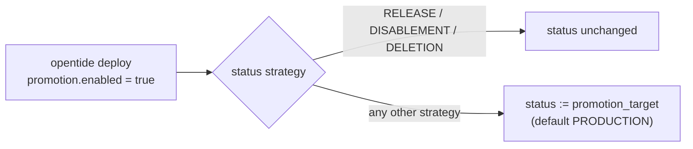

# Deployment lifecycle

## Summary

Defines rule deployment statuses and the strategy each maps to, the deployment plans that select rules by strategy, promotion, and debug configuration. Shipped in bundled `deployment.toml`; clients MAY override via `.opentide/configurations/deployment.toml`.

## Requirements

- Every rule `status` value MUST match a configured status `name` in merged `deployment.toml`.
- The set of statuses is configuration, not specification: implementations MUST NOT assume the bundled status names exist.
- Status ordering is NOT normative. No transition graph is defined or enforced; any configured status MAY be set directly.
- Status promotion MUST respect `[promotion]` settings when `promotion.enabled` is true.
- Deprecated statuses MUST NOT be used for new rules (opentide emits warnings).
- Platform-specific `status` on configuration blocks MUST also be valid deployment statuses when set.
- For Defender for Endpoint, SentinelOne, and CrowdStrike, update, disablement, and deletion MUST use the tenant binding in [deployment state](deployment-state.md). A `RELEASE` or `PREVIEW` action with no binding MUST NOT create a remote rule unless the deployment-state destination is not ignored and the binding can be durably retained.
- `opentide deploy` MUST select only the rule files placed directly in the configured rules directory (`paths.objects.rule`, see [workspace layout](workspace.md)). A rule file in a subdirectory of that folder MUST NOT be deployed.
- A deployment plan MUST select rules by the strategy of their status, never by the status name ([Deployment plans](#deployment-plans)). Plan names are fixed by this specification; they MUST NOT be read as status names, and status names MUST NOT be read as plans.
- `deployment.toml` carries no proxy settings. A `[proxy]` table MUST fail the command and name the global proxy option ([Network proxy](#network-proxy)).

## Definition

### Status entries (`[[statuses]]`)

| Field | Type | Required | Description |
|-------|------|----------|-------------|
| `name` | string | yes | Status identifier (e.g. `STAGING`) |
| `description` | string | yes | Human-readable description |
| `strategy` | string | yes | Deployment strategy enum |

### Bundled statuses

| Name | Strategy | Description |
|------|----------|-------------|
| `DESIGN` | `INERT` | Under active functional design, without technical translation |
| `DEVELOPMENT` | `PREVIEW` | Under active technical implementation |
| `IMPROVING` | `PREVIEW` | Functionally qualified, undergoing refinement |
| `STAGING` | `PREVIEW` | Deployed in staging for operational testing |
| `ACCEPTANCE` | `PREVIEW` | Ready for production; analyst validates alert and playbook |
| `PRODUCTION` | `RELEASE` | Active production deployment |
| `DISABLED` | `DISABLEMENT` | Accessible but not active |
| `REMOVED` | `DELETION` | Fully deprecated, archival flag only |

### Strategy semantics

The `strategy` on a status determines what `opentide deploy` does with a rule in that status:

| Strategy | Deploy behaviour | Deployed by plan |
|----------|------------------|------------------|
| `INERT` | Rule is not deployed to any platform | none |
| `PREVIEW` | Rule is deployed to staging/preview targets only | `STAGING`, `FULL` |
| `RELEASE` | Rule is deployed to production targets | `PRODUCTION`, `FULL` |
| `DISABLEMENT` | Any active deployment of the rule is disabled (kept but inactive) | `PRODUCTION`; `FULL` when the run keeps deprecated rules |
| `DELETION` | The rule is removed from platforms | `PRODUCTION`; `FULL` when the run keeps deprecated rules |
| `UNIVERSAL` | Rule is deployed by both the pull-request and the default-branch plan | `STAGING`, `PRODUCTION`, `FULL` |

No bundled status uses `UNIVERSAL`; a client status MAY.

### Deployment plans

A deployment plan names the pipeline a run belongs to. It is chosen per run with `opentide deploy --plan` or `DEPLOYMENT_PLAN`, and defaults to `FULL`. A plan is not a status: it selects the rules whose status **strategy** it deploys, whatever the status is called, so the plan names never have to match a configured status. The bundled `STAGING` and `PRODUCTION` statuses share a name with two plans by convention only.

| Plan | Pipeline | Rule files read | Strategies deployed | Tenants targeted |
|------|----------|-----------------|---------------------|------------------|
| `STAGING` | Pull or merge request | Those the request changed, from its merge base | `PREVIEW`, `UNIVERSAL` | `deployment = "STAGING"` or `"ALWAYS"`; `"MANUAL"` when the block lists it |
| `PRODUCTION` | Push to the default branch | Those the push changed | `RELEASE`, `UNIVERSAL`, `DISABLEMENT`, `DELETION` | `deployment = "PRODUCTION"` or `"ALWAYS"`; `"MANUAL"` when the block lists it |
| `FULL` | Any; the default outside CI | Every rule file | `PREVIEW`, `RELEASE`, `UNIVERSAL`; `DISABLEMENT` and `DELETION` when the run keeps deprecated rules | `deployment = "ALWAYS"`; `"MANUAL"` when the block lists it |

`PRODUCTION` keeps deprecated rules (`DISABLEMENT`, `DELETION`) unless the run drops them (`opentide deploy --drop-deprecated`); `FULL` drops them unless the run keeps them (`--keep-deprecated`), so a full redeploy does not retire the archived catalogue by accident. The rule files read follow the rules-directory requirement above. A block's `tenants` list (see [platforms/index.md](platforms/index.md)) limits a rule to the tenants it names. With the bundled statuses, `STAGING` therefore deploys a rule in `DEVELOPMENT`, `IMPROVING`, `STAGING`, or `ACCEPTANCE`, and `PRODUCTION` a rule in `PRODUCTION`, `DISABLED`, or `REMOVED`. A client status `CANARY` with strategy `PREVIEW` is deployed by `STAGING`, and a client that maps a status named `STAGING` to `RELEASE` has it deployed by `PRODUCTION`.

A status strategy is not a plan name. An implementation MUST refuse a plan named after a strategy (`PREVIEW`, `RELEASE`, …), and SHOULD name the plan that deploys that strategy. `ALWAYS`, `MANUAL`, and `DEBUG` are tenant classes or implementation plans, not CI diff plans; a CI diff under them MUST fail rather than read every rule.

The tenant `deployment` key in a platform's workspace configuration uses the plan names as tenant classes: `STAGING` and `PRODUCTION` tenants receive their plan's deploys, `ALWAYS` tenants every plan's, and `MANUAL` tenants only the rules whose block lists them.

Live query validation (`opentide validate query --live`) reads the same plans but only reads from tenants, so under `FULL` it checks every tenant a rule can reach ([validation.md](validation.md#query-validation)).

### Status changes and promotion

There is **no lifecycle state machine**. Statuses are a flat, configurable set: the only constraint enforced on a rule is that its `status` matches a configured status `name`. Any status MAY be set directly in YAML, in any order, and no transition is validated.

Promotion, when `promotion.enabled` is true, is a single jump — not a step along a progression:

| Status strategy | Effect of promotion |
|-----------------|---------------------|
| `RELEASE`, `DISABLEMENT`, `DELETION` | Non-promotable; the status is left unchanged |
| Any other strategy (e.g. `INERT`, `PREVIEW`) | Rewritten **directly** to `promotion.promotion_target` |

Intermediate statuses are not stepped through: a rule in the bundled `DESIGN` status promotes straight to `PRODUCTION`. Promotion rewrites the `status` values inside a rule's platform `configurations` blocks.

The bundled status names in the table above suggest an editorial workflow (design → build → stage → release → retire), but that ordering is **convention only** and applies solely to the bundled configuration. Clients that override `deployment.toml` define their own statuses, and any progression between them is enforced by their own process, not by opentide.

### Vendor-assigned rule ids

For Defender for Endpoint, SentinelOne, and CrowdStrike, update, disablement, and deletion require the tenant binding in deployment state ([deployment-state.md](deployment-state.md)). A release or preview action with no binding creates a remote rule only when the destination is not ignored and the binding can be durably retained. `DISABLEMENT` and `DELETION` with no binding report `external_id_missing` (a warning) and make no vendor call.

| Strategy | Binding present | No binding |
|----------|-----------------|------------|
| `PREVIEW`, `RELEASE` | Update the remote rule | Create and record the returned id; refused with `deployment_state_ignored` when the shard directory is gitignored, and with `deployment_state_unpersisted` in a CI run under any deployment plan other than `PRODUCTION` |
| `DISABLEMENT` | Update the remote rule as disabled; keep the binding | `external_id_missing` (warning), no vendor call |
| `DELETION` | Delete the remote rule, then remove the binding | `external_id_missing` (warning), no vendor call |
| `INERT` | Not deployed | Not deployed |

A rule that carries `rule_id`, `rule_id_bundle`, or `rule_id::<tenant>` on any platform block is refused before any platform client is built (`external_id_in_rule`). Deploy continues with independent rules and exits 1 when any selected rule reported an error. The strategies themselves are unchanged. Sentinel, Splunk, HarfangLab, Carbon Black Cloud, and Elastic address rules without a vendor-assigned id and never use deployment state.

### `[promotion]`

| Field | Type | Default | Description |
|-------|------|---------|-------------|
| `enabled` | boolean | `true` | Whether status promotion is allowed |
| `promotion_target` | string | `PRODUCTION` | Default target status for promotion |

### Network proxy

`deployment.toml` has no proxy settings. The proxy for platform and lookup calls is the global `opentide --proxy http://[user:pass@]host:port` option, or `OPENTIDE_PROXY` when the option is omitted. It applies to the `opentide` process only, overriding `HTTP_PROXY` and `HTTPS_PROXY`; without it the process environment's proxy variables apply. Hosts listed in `NO_PROXY` MUST be reached directly in either case, so one run can reach a cloud tenant through the proxy and an internal tenant without it.

A `[proxy]` table in `deployment.toml`, a `proxy` key under a tenant's `[tenants.setup]`, and `[cve].proxy` in `documentation.toml` are retired: each MUST fail the command and name `opentide --proxy`. opentide 0.10.0 retired them; until version 1.3 this specification still described `[proxy]` (`proxy_user`, `proxy_password`, `proxy_host`, `proxy_port`).

### `[debug]`

| Field | Type | Description |
|-------|------|-------------|
| `mdr_test_uuids` | list[string] | UUIDs of rules usable for debugging |
| `proxy_enabled` | boolean | Enable proxy in debug mode |
| `ssl_enabled` | boolean | Enable SSL in debug mode |

### Top-level

| Field | Default | Description |
|-------|---------|-------------|
| `default_responders` | `""` | Default responder team when not set on rule |

## Relationships

- [rule-1.0.md](objects/rule-1.0.md) — `status` field on rules and platform blocks
- [configuration.md](configuration.md) — override mechanism
- [platforms/index.md](platforms/index.md) — per-platform deployment
- [deployment-state.md](deployment-state.md) — vendor-assigned rule ids, deploy decisions, and the production write-back
- [metaschema-keywords.md](metaschema-keywords.md) — `tide.config.statuses` keyword
- [validation.md](validation.md#query-validation) — live query validation under a plan
- [workspace.md](workspace.md#ci-jobs) — the generated jobs that run each plan

## Defaults & overrides

Bundled `deployment.toml` ships in opentide. Override via `.opentide/configurations/deployment.toml`. Deep merge applies.

## Examples

Default rule status in fixtures: `STAGING` — see [fixtures/valid/rule-1.0.yaml](../fixtures/valid/rule-1.0.yaml).

## History

| Version | Date | Notes |
|---------|------|-------|
| 1.0 | 2026-06-25 | Initial spec from opentide `deployment.toml` |
| 1.1 | 2026-10-16 | Vendor-assigned rule ids: update, disablement, and deletion on Defender for Endpoint, SentinelOne, and CrowdStrike use the binding in [deployment state](deployment-state.md); creates require a destination that is not ignored and a run that can persist state; `external_id_missing` is a warning ([RFC 0010](../rfcs/0010-deployment-external-ids.md)). |
| 1.2 | 2026-10-19 | `opentide deploy` selects only rule files placed directly in the configured rules directory; a rule file in a subfolder is not deployed ([specifications#16](https://github.com/opentidehq/specifications/pull/16)). |
| 1.3 | 2026-10-20 | Deployment plans are specified: `STAGING`, `PRODUCTION`, and `FULL` name a pipeline and select rules by status strategy, never by status name; a strategy given as a plan is refused. The tenant `deployment` classes are listed, and `UNIVERSAL` joins the strategy table as implemented. `[proxy]` is replaced by the global `opentide --proxy` / `OPENTIDE_PROXY` with `NO_PROXY` honoured; the table, retired by opentide 0.10.0, is refused. |
