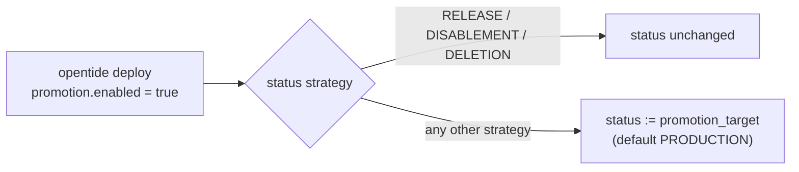

# Deployment lifecycle

## Summary

Defines rule deployment statuses, promotion strategy, proxy settings, and debug configuration. Shipped in bundled `deployment.toml`; clients MAY override via `.opentide/configurations/deployment.toml`.

## Requirements

- Every rule `status` value MUST match a configured status `name` in merged `deployment.toml`.
- The set of statuses is configuration, not specification: implementations MUST NOT assume the bundled status names exist.
- Status ordering is NOT normative. No transition graph is defined or enforced; any configured status MAY be set directly.
- Status promotion MUST respect `[promotion]` settings when `promotion.enabled` is true.
- Deprecated statuses MUST NOT be used for new rules (opentide emits warnings).
- Platform-specific `status` on configuration blocks MUST also be valid deployment statuses when set.
- For SentinelOne and CrowdStrike, update, disablement, and deletion MUST use the tenant binding in [deployment state](deployment-state.md). A `RELEASE` or `PREVIEW` action with no binding MUST NOT create a remote rule unless the deployment-state destination is not ignored and the binding can be durably retained.
- For Microsoft Defender (`microsoft_defender`), create, update, disablement, and deletion MUST address the Defender rule by the rule's `metadata.uuid` and MUST NOT need a binding ([microsoft-defender-1.0](platforms/microsoft-defender-1.0.md#deploy)). A block of the retired platform `defender_for_endpoint` MUST be refused (`defender_platform_retired`).
- `opentide deploy` MUST NOT retire a rule whose file was deleted unless `--prune` is given on a run that includes the `RELEASE` strategy ([Retiring deleted rules](#retiring-deleted-rules)). Without it, a deploy MUST report the retirable rules and send nothing for them.
- `opentide deploy` MUST select only the rule files placed directly in the configured rules directory (`paths.objects.rule`, see [workspace layout](workspace.md)). A rule file in a subdirectory of that folder MUST NOT be deployed.

## Definition

### Status entries (`[[statuses]]`)

| Field | Type | Required | Description |
|-------|------|----------|-------------|
| `name` | string | yes | Status identifier (e.g. `STAGING`) |
| `description` | string | yes | Human-readable description |
| `strategy` | string | yes | Deployment strategy enum |

### Bundled statuses

| Name | Strategy | Description |
|------|----------|-------------|
| `DESIGN` | `INERT` | Under active functional design, without technical translation |
| `DEVELOPMENT` | `PREVIEW` | Under active technical implementation |
| `IMPROVING` | `PREVIEW` | Functionally qualified, undergoing refinement |
| `STAGING` | `PREVIEW` | Deployed in staging for operational testing |
| `ACCEPTANCE` | `PREVIEW` | Ready for production; analyst validates alert and playbook |
| `PRODUCTION` | `RELEASE` | Active production deployment |
| `DISABLED` | `DISABLEMENT` | Accessible but not active |
| `REMOVED` | `DELETION` | Fully deprecated, archival flag only |

### Strategy semantics

The `strategy` on a status determines what `opentide deploy` does with a rule in that status:

| Strategy | Deploy behaviour |
|----------|------------------|
| `INERT` | Rule is not deployed to any platform |
| `PREVIEW` | Rule is deployed to staging/preview targets only |
| `RELEASE` | Rule is deployed to production targets |
| `DISABLEMENT` | Any active deployment of the rule is disabled (kept but inactive) |
| `DELETION` | The rule is removed from platforms |
| `UNIVERSAL` | Rule is deployed to both staging/preview and production targets |

No bundled status uses `UNIVERSAL`; a client status MAY.

### Status changes and promotion

There is **no lifecycle state machine**. Statuses are a flat, configurable set: the only constraint enforced on a rule is that its `status` matches a configured status `name`. Any status MAY be set directly in YAML, in any order, and no transition is validated.

Promotion, when `promotion.enabled` is true, is a single jump — not a step along a progression:

| Status strategy | Effect of promotion |
|-----------------|---------------------|
| `RELEASE`, `DISABLEMENT`, `DELETION` | Non-promotable; the status is left unchanged |
| Any other strategy (e.g. `INERT`, `PREVIEW`) | Rewritten **directly** to `promotion.promotion_target` |

Intermediate statuses are not stepped through: a rule in the bundled `DESIGN` status promotes straight to `PRODUCTION`. Promotion rewrites the `status` values inside a rule's platform `configurations` blocks.

The bundled status names in the table above suggest an editorial workflow (design → build → stage → release → retire), but that ordering is **convention only** and applies solely to the bundled configuration. Clients that override `deployment.toml` define their own statuses, and any progression between them is enforced by their own process, not by opentide.

### Vendor-assigned rule ids

For SentinelOne and CrowdStrike, update, disablement, and deletion require the tenant binding in deployment state ([deployment-state.md](deployment-state.md)). A release or preview action with no binding creates a remote rule only when the destination is not ignored and the binding can be durably retained. `DISABLEMENT` and `DELETION` with no binding report `external_id_missing` (a warning) and make no vendor call.

| Strategy | Binding present | No binding |
|----------|-----------------|------------|
| `PREVIEW`, `RELEASE` | Update the remote rule | Create and record the returned id; refused with `deployment_state_ignored` when the shard directory is gitignored, and with `deployment_state_unpersisted` in a CI run other than a `RELEASE` run on a push |
| `DISABLEMENT` | Update the remote rule as disabled; keep the binding | `external_id_missing` (warning), no vendor call |
| `DELETION` | Delete the remote rule, then remove the binding | `external_id_missing` (warning), no vendor call |
| `INERT` | Not deployed | Not deployed |

A rule that carries `rule_id`, `rule_id_bundle`, or `rule_id::<tenant>` on any platform block is refused before any platform client is built (`external_id_in_rule`). Deploy continues with independent rules and exits 1 when any selected rule reported an error. The strategies themselves are unchanged. Sentinel, Splunk, HarfangLab, Carbon Black Cloud, and Elastic address rules without a vendor-assigned id and never use deployment state.

Microsoft Defender ([`microsoft_defender`](platforms/microsoft-defender-1.0.md), which replaces `defender_for_endpoint`) addresses its rule by `metadata.uuid`: a `PREVIEW` or `RELEASE` update that finds no rule (HTTP 404) creates it, and a `DISABLEMENT` or `DELETION` that finds none sends nothing more. No strategy reports `external_id_missing`, and no create is refused for want of persisted state. A legacy binding recorded under `defender_for_endpoint` before opentide 1.0 is retired by the first `microsoft_defender` deploy to that tenant: the uuid rule is deployed, then the legacy rule is deleted and the binding removed ([Legacy rules](platforms/microsoft-defender-1.0.md#legacy-rules)).

### Retiring deleted rules

A **retirable rule** is a rule that `opentide deploy` deployed earlier, whose object file is gone, and whose `metadata.uuid` no object file in the workspace still holds. A moved or renamed file is not retirable. A deploy finds retirable rules only from two kinds of evidence:

1. **Orphan binding.** On a platform that keeps vendor ids in [deployment state](deployment-state.md), each `platforms.<platform>.<tenant>` entry of a shard whose rule is not in the object registry. A change-detection run reads the shards of the rule files its diff deleted; an `--all` run reads every shard. A binding for a tenant that is no longer configured is not retired: it is kept, and the run warns.
   A legacy Defender binding ([deployment-state.md](deployment-state.md#legacy-defender-bindings)) is an orphan binding like any other.
2. **Deleted rule file.** On a platform that keeps no ids (Sentinel, Splunk, Elastic, HarfangLab, Carbon Black Cloud, and Microsoft Defender), a rule file deleted in a change-detection run's diff, read as the diff's base commit held it. Each platform block whose status maps to `PREVIEW`, `RELEASE`, `UNIVERSAL` or `DISABLEMENT` is retirable on the configured tenants that status reached. A block whose status maps to `DELETION` or `INERT` is not. An `--all` run cannot find these rules: there is no shard.

**Without `--prune`** (every strategy, dry run or not): nothing is sent and deployment state is unchanged. The run adds a warning naming the retirable rules and, in `--json`, a top-level `retirable` array with one entry per rule and tenant (`platform`, `tenant`, `uuid`, `name`, `status`, `action: "delete"`, and `unsupported` with a reason where the platform cannot retire it). The exit code is unchanged.

**With `--prune`:** the run MUST include the `RELEASE` strategy and MUST NOT be narrowed with `--uuid` or `--file`; otherwise it is a usage error (exit 2). A dry run shows the retirements as plan rows and sends nothing. Otherwise, after each platform's own rules, each tenant is opened as for a deploy (a tenant that cannot be opened leaves its retirements `not_attempted`), and each retirable rule is deleted:

| Platform | Retirement |
|----------|------------|
| Platforms that keep ids | Delete of the id the binding records; on success the binding is removed as for `DELETION` |
| Microsoft Defender | A deleted `microsoft_defender` block: delete of the detection rule whose id is the UUID. An orphan legacy binding: delete of the id it records, then the binding is removed |
| Sentinel | Delete of the analytics rule named by the UUID |
| Elastic | Delete of the detection rule whose `rule_id` is the UUID |
| HarfangLab | Delete of the UUID at the endpoint of the deleted block's kind |
| Splunk | Delete of the saved search named after the deleted file's `name`, then of every saved search of the app whose description ends `opentide rule <uuid>` |
| Carbon Black Cloud | Not supported: the row is `skipped`; the report is removed from the watchlist by hand |

A delete the tenant answers with HTTP 404, where the connector reports the status, is `skipped` ("already gone from the tenant") and its binding is forgotten. A rule deleted from the diff on a platform that keeps ids, with no binding for that platform, is neither sent nor reported (the binding is the only proof; this is not `external_id_missing`).

A retirement is a `delete` row of the deploy result marked `retired`. A failed retirement fails the run (exit 1, `issues_found`); a skipped one does not. A run whose only work is retirements has completed.

Nothing is retired, and the run warns, when any object file fails to load, when an `--all` run reads no rule, or when the diff's deletions cannot be read. A shallow checkout or a missing diff base fails the run as before; a push that created its branch has no deletions.

### `[promotion]`

| Field | Type | Default | Description |
|-------|------|---------|-------------|
| `enabled` | boolean | `true` | Whether status promotion is allowed |
| `promotion_target` | string | `PRODUCTION` | Default target status for promotion |

### `[proxy]`

| Field | Description |
|-------|-------------|
| `proxy_user` | Optional; use with `proxy_password` for auth |
| `proxy_password` | Optional proxy password (env var substitution supported) |
| `proxy_host` | Proxy hostname |
| `proxy_port` | Proxy port |

When both `proxy_user` and `proxy_password` are present, authenticated proxy is used; otherwise host:port only.

### `[debug]`

| Field | Type | Description |
|-------|------|-------------|
| `mdr_test_uuids` | list[string] | UUIDs of rules usable for debugging |
| `proxy_enabled` | boolean | Enable proxy in debug mode |
| `ssl_enabled` | boolean | Enable SSL in debug mode |

### Top-level

| Field | Default | Description |
|-------|---------|-------------|
| `default_responders` | `""` | Default responder team when not set on rule |

## Relationships

- [rule-1.0.md](objects/rule-1.0.md) — `status` field on rules and platform blocks
- [configuration.md](configuration.md) — override mechanism
- [platforms/index.md](platforms/index.md) — per-platform deployment
- [deployment-state.md](deployment-state.md) — vendor-assigned rule ids, deploy decisions, and the production write-back
- [metaschema-keywords.md](metaschema-keywords.md) — `tide.config.statuses` keyword

## Defaults & overrides

Bundled `deployment.toml` ships in opentide. Override via `.opentide/configurations/deployment.toml`. Deep merge applies.

## Examples

Default rule status in fixtures: `STAGING` — see [fixtures/valid/rule-1.0.yaml](../fixtures/valid/rule-1.0.yaml).

## History

| Version | Date | Notes |
|---------|------|-------|
| 1.0 | 2026-06-25 | Initial spec from opentide `deployment.toml` |
| 1.1 | 2026-10-16 | Vendor-assigned rule ids: update, disablement, and deletion on Defender for Endpoint, SentinelOne, and CrowdStrike use the binding in [deployment state](deployment-state.md); creates require a destination that is not ignored and a run that can persist state; `external_id_missing` is a warning ([RFC 0010](../rfcs/0010-deployment-external-ids.md)). |
| 1.2 | 2026-10-19 | `opentide deploy` selects only rule files placed directly in the configured rules directory; a rule file in a subfolder is not deployed ([specifications#16](https://github.com/opentidehq/specifications/pull/16)). |
| 1.5 | 2026-11-25 | Microsoft Defender (`microsoft_defender`, replacing `defender_for_endpoint`) addresses its rule by `metadata.uuid` ([microsoft-defender-1.0](platforms/microsoft-defender-1.0.md), [RFC 0021](../rfcs/0021-defender-graph-beta-detection-rules.md)): no binding is needed for update, disablement, deletion, or create, and a `defender_for_endpoint` block is refused (`defender_platform_retired`). Legacy bindings are retired on the next `microsoft_defender` deploy, or by `--prune` when the rule file is gone. |
| 1.4 | 2026-11-24 | [Retiring deleted rules](#retiring-deleted-rules): a deploy reports rules whose file was deleted (`retirable`) and, with `--prune` on a `RELEASE` run, deletes them from the tenants they reached (opentide#1713, opentide#1849). Additive: without `--prune` nothing is sent. |
| 1.3 | 2026-10-20 | `UNIVERSAL` joins the strategy table. opentide already accepts it for a status `strategy`; the spec did not list it. Additive. The `deployment_state_unpersisted` condition names a run by its strategies, not a deployment plan. |
